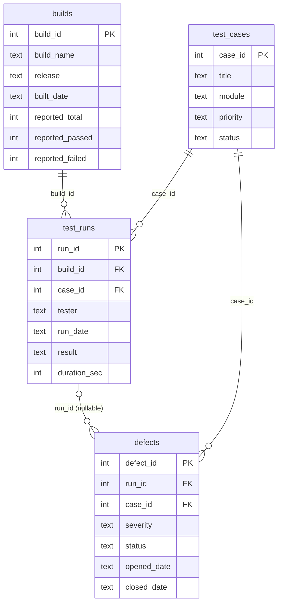

# Lab: Release Tracker Data Validation and the Week 2 Integration

**Week 2 / 5-friday: SQL Joins & Data Validation** | Mode A (Code Lab) | Individual | Time-box: about 3 hours (2 h 45 min of tasks + 15 min buffer)

---

## The scenario

Your team tests a web shop. Test results live in four tables that were exported from different tools: **builds** (CI summaries),
**test_cases**, **test_runs** (one execution of a case in a build) and **defects**. A release manager has asked one question:

> "Can I trust the numbers in the release report?"

Nobody has checked the data. You will answer with SQL: you will practise changing data safely (Part A), join the tables (B),
ask questions with subqueries (C) and aggregates (D), then turn your queries into a **20-check data-quality suite** (E)
and wire it into your **qe-foundations** repo so that one command ingests the data, runs the suite, logs everything and prints a
**PASS/FAIL** verdict (F).

The data is **deliberately dirty**: orphan foreign keys, duplicates, NULLs, bad values, totals that do not add up, missing rows.
Your job is to *measure* the problems, not to clean them (except in the practice tasks of Part A).



Business rules you may assume are TRUE for good data: results are `pass`, `fail` or `skip`; durations are 1 to 3600 seconds;
priorities are P1/P2/P3; severities are low/medium/high/critical; defect status is open/fixed/closed; one run per (build, case);
every failed run has a defect; a defect that points to a run points to a **failed** run of the **same case**. The full list of
rules is the list of checks in Part E.

---

## Project 1 milestone (QE Foundations)

> **Friday milestone: join and aggregate validation across 3+ tables, plus the Week 2 integration.**
> By the end of today your `qe-foundations` repo contains a SQL validation suite that checks **four tables** with joins, subqueries and
> GROUP BY/HAVING, and a single command, `python -m qe_foundations.report`, that ties together everything from this week:

| Day | What you built | Where it shows up in the final command |
|---|---|---|
| Monday | repo structure, virtual environment, `requirements.txt`, packages and imports | `qe_foundations/` package, `python -m ...` works from the repo root |
| Tuesday | file ingestion with custom exceptions (CSV and JSON) | `ingestion/` loads `data/*.csv|json` into SQLite; bad files raise your exceptions, exit code 2 |
| Wednesday | logging and `unittest` | every check outcome is logged; `tests/` proves the suite works, including that a check can fail |
| Thursday | single-table validation queries (violation queries) | the "zero rows = PASS" idea behind every check |
| Friday | joins, subqueries, GROUP BY / HAVING, DML and constraints | `sql/part_e_checks.sql`: 20 cross-table checks |

Repo layout after today (the self-check expects exactly these locations):

```text
qe-foundations/
  qe_foundations/
    __init__.py
    report.py                  <- python -m qe_foundations.report   (Friday)
    utils/                     <- your logging helper (Wednesday) and other utilities
    ingestion/                 <- your Tuesday loaders/exceptions + sqlite_loader.py (Friday)
    validation/                <- your Thursday code + sql_checks.py (Friday)
  tests/                       <- needs __init__.py; Wednesday tests + test_sql_checks.py
  data/                        <- builds.csv, test_cases.csv, test_runs.json, defects.json, clean/, malformed/
  sql/                         <- schema.sql, part_e_checks.sql
  docs/                        <- DATA_QUALITY_FINDINGS.md, WEEK2_REFLECTION.md
  requirements.txt
  .gitignore
  README.md
```

---

## What you need to have read / seen

Everything you need was taught Monday to Friday. Nothing else is required (no window functions, no indexes, no ORMs, no pytest).

| Part | Lessons (written/) | Demo |
|---|---|---|
| A | 5-friday: insert-update-and-delete, basic-database-constraints-primary-and-foreign-keys | demos/5-friday (DML and constraints sections) |
| B | 5-friday: inner-join, left-and-right-join, full-join, multi-table-queries | demos/5-friday (join parts) |
| C | 5-friday: subqueries (and Thursday: filtering-and-sorting-data for NULL logic) | demos/5-friday |
| D | 5-friday: group-by-and-having, aggregate-functions | demos/5-friday |
| E | 5-friday: test-data-validation-using-sql; 4-thursday: using-sql-for-qa-data-validation | demos/5-friday (validation part) |
| F | 1-monday modules/venv/packages, 2-tuesday csv-json-and-xml + custom exceptions, 3-wednesday logging + unit testing, git (Monday and Wednesday) | demos 1 to 5 |

The Friday demo used a different database ("QA Shop"). **Do not copy its queries blindly**: the table names, the planted defects and some of the traps are different here.

---

## Time plan

| Part | Topic | Time-box | Deliverable |
|---|---|---|---|
| A | DML + constraints (INSERT / UPDATE / DELETE safely, PK, FK, CHECK, UNIQUE, transactions) | 25 min | `sql/part_a_dml.sql` |
| B | Joins: INNER, LEFT, RIGHT, FULL and the emulation | 30 min | `sql/part_b_joins.sql` |
| C | Subqueries (IN, NOT IN trap, NOT EXISTS, scalar) | 25 min | `sql/part_c_subqueries.sql` |
| D | GROUP BY, HAVING, aggregates | 25 min | `sql/part_d_aggregates.sql` |
| E | The 20-check validation suite and the findings report | 35 min | `sql/part_e_checks.sql`, `EXPECTED_FINDINGS.md` filled in |
| F | Week 2 integration in `qe-foundations` + tests + reflection + submission | 45 min | repo with `python -m qe_foundations.report`, tag `week2-complete` |
| | Buffer, self-check, commit | 15 min | |

If a part overruns by more than 10 minutes, **move on** and come back: Part E and F need B to D, but not all of them in perfect shape
(use the hints). The self-check tells you what is still open at any moment.

---

## Setup (5 minutes)

Work in `starter_code/` for Parts A to E. Everything runs with Python's built-in `sqlite3`: no installation needed.

**PowerShell (Windows)**

```powershell
cd path\to\exercise\5-friday\starter_code
python --version
python -c "import sqlite3; print(sqlite3.sqlite_version)"
python lab_runner.py sql/part_a_dml.sql --only A1
python check_exercise.py --part A
```

**bash (macOS / Linux / Git Bash)**

```bash
cd path/to/exercise/5-friday/starter_code
python3 --version
python3 -c "import sqlite3; print(sqlite3.sqlite_version)"
python3 lab_runner.py sql/part_a_dml.sql --only A1
python3 check_exercise.py --part A
```

(On Windows use `python` or `py`; on macOS/Linux `python3`. The rest of this README writes `python`.)

**SQLite version note.** `RIGHT JOIN` and `FULL JOIN` need SQLite **3.39.0 or newer** (Python 3.11 and later normally include it).
If `sqlite_version` printed something older, or if you later run the queries on MySQL (which has `RIGHT JOIN` but no `FULL JOIN`), do tasks B4/B5
in their **emulation form**: a RIGHT JOIN is a LEFT JOIN with the two tables swapped, and a FULL JOIN is
`LEFT JOIN anti-join UNION ALL LEFT JOIN anti-join` (exactly what B6 asks for). B6 must give the same rows as B5, so you can write B6 first and
just copy it into B5 as a LEFT-JOIN-only variant. The self-check accepts any query that returns the right rows.

### How the files work

- Each task is a block starting with `-- @Q <id> <title>` followed by comments (the task, `RETURNS:` columns, hints) and a placeholder `SELECT 'TODO' AS todo;`. **Replace the placeholder with your SQL.** Statements marked `(given)` are already written: do not edit them.
- `python lab_runner.py sql/part_b_joins.sql` runs a whole file; add `--only B3` to show one task. Each run uses a **fresh in-memory copy** of the database, so you cannot break `seed.sql`.
- Return **exactly the columns named in `RETURNS:`, in that order**. Aliases and row order do not matter.
- `python check_exercise.py` compares your results with the expected ones and says PASS / FAIL / TODO per task, with a hint when something is wrong. Run it often.

---

## Part A: DML and constraints practice (25 min)

File: `sql/part_a_dml.sql` (tasks A1 to A8). All tasks run in **one session, top to bottom**, on a throw-away copy.

| Task | What you do | Concept |
|---|---|---|
| A1 | `PRAGMA foreign_key_check;` lists existing orphans (5 rows) | the database declares FKs but never enforced them |
| A2 | Turn enforcement ON, then try to insert a run for case 999: it must be **rejected** | `PRAGMA foreign_keys = ON` per connection, referential integrity |
| A3 | Insert a build (named columns), then two runs with **one** multi-row INSERT | INSERT syntax |
| A4 | **Preview with SELECT**, then UPDATE the one run whose result is `PASSED` | the golden rule: same WHERE for the preview and the change |
| A5 | Preview, then DELETE only the surplus copy of a duplicated run | DELETE with a precise WHERE |
| A6 | Create `quarantine_runs`, `INSERT ... SELECT` the orphan runs into it, then DELETE them from `test_runs` using a subquery | moving rows safely, no hard-coded ids |
| A7 | Build `test_cases_strict` with PK, NOT NULL, CHECK, UNIQUE, DEFAULT; **predict** the result of three bad inserts, then run them | constraints reject bad data |
| A8 | BEGIN, `DELETE FROM defects` (no WHERE, on purpose), look, ROLLBACK | transactions as a safety net |

**Rules:** never run an UPDATE or DELETE without having run the matching SELECT first. Write down (in your head or in
`EXPECTED_FINDINGS.md`, section 3) what you predicted for A2 and A7 before you ran them.

Self-check: `python check_exercise.py --part A`

## Part B: Joins (30 min)

File: `sql/part_b_joins.sql` (B1 to B7).

| Task | Join type | Question |
|---|---|---|
| B1 | INNER (3 tables) | every run that has both a build and a case (expect 40 rows) |
| B2 | LEFT + `IS NULL` | cases that were never run |
| B3 | LEFT + `IS NULL` | builds with no run |
| B4 | RIGHT | runs whose case does not exist (3 rows: why 3?) |
| B5 | FULL + CASE | mismatches on both sides, labelled |
| B6 | emulation | the same 6 rows as B5 without RIGHT/FULL JOIN |
| B7 | 4-table INNER | defects with build name, case title and severity |

Think about each result: **which rows disappeared, and why?** An INNER JOIN silently drops the very rows a tester cares about.

Self-check: `python check_exercise.py --part B`

## Part C: Subqueries (25 min)

File: `sql/part_c_subqueries.sql` (C1 to C5).

- **C2 is a trap on purpose.** The `NOT IN` version of "cases never run" returns **zero rows** although B2 found three. Find out why (look at `test_runs.case_id`) and explain it in one sentence in `EXPECTED_FINDINGS.md`.
- C3 fixes it with `NOT EXISTS`.
- C4a/C4b show how one bad value (a duration of 86400) distorts an average, and how to protect a baseline by filtering **inside** the subquery.

Self-check: `python check_exercise.py --part C`

## Part D: GROUP BY, HAVING and aggregates (25 min)

File: `sql/part_d_aggregates.sql` (D1 to D6): conditional aggregation (`SUM(CASE ...)`), duplicates with `HAVING COUNT(*) > 1`, failure rate per module
(`100.0 *` to avoid integer division, `ROUND`), profiling a column, **reconciling reported totals against real counts** (D5, the engine of checks E-01/E-02) and WHERE vs HAVING (D6).

Self-check: `python check_exercise.py --part D`

## Part E: The multi-table validation suite (35 min) - Project 1 milestone core

File: `sql/part_e_checks.sql`. Twenty checks (E-01 to E-20) over all four tables. **Three are written for you** (E-14, E-16, E-20) as worked examples; you write the other 17.
Most of them are a small adaptation of something you did in B, C or D (each header names the technique).

Format of a check (the Python code in Part F reads exactly this):

```sql
-- @CHECK E-10 | referential | test_runs.case_id (when given) exists in test_cases | returns test_runs.run_id
SELECT r.run_id
FROM test_runs AS r
LEFT JOIN test_cases AS c ON c.case_id = r.case_id
WHERE r.case_id IS NOT NULL AND c.case_id IS NULL;
```

**Rules:** the query returns the **violating rows** (zero rows = PASS); the first column is the primary key of the offending row **of the table named in `returns`**;
each offending row appears **once**; the query is a plain SELECT.

Categories you cover: reconciliation (E-01, E-02), missing rows (E-03, E-04), uniqueness (E-05, E-06), completeness (E-07 to E-09),
referential integrity (E-10 to E-13), validity (E-14, E-15), business rules and cross-table consistency (E-16 to E-20).

Run the suite: `python lab_runner.py --checks sql/part_e_checks.sql --show` (add `--only E-05` for one check).
A check that is still a placeholder is reported as **TODO** and counts as **not done**, never as PASS.

Then fill in **`EXPECTED_FINDINGS.md`**: the prediction round (before you run the suite), one row per check (count, ids, severity, root cause, draft bug title),
five short answers to questions the data asked, and your top 3 risks.

Self-check: `python check_exercise.py --part E`

## Part F: Week 2 integration in `qe-foundations` (45 min)

You now turn the suite into a tool. The goal is one command:

```text
python -m qe_foundations.report [--data data] [--db :memory:] [--checks sql/part_e_checks.sql] [--schema sql/schema.sql] [--log-file logs/report.log] [--show]
```

### F.0 Prepare the repo

Work on a branch (a good habit; merge it when done). From your qe-foundations repo, with your virtual environment **active**:

```powershell
# PowerShell
git switch main; git pull
git switch -c week2-friday
.\.venv\Scripts\Activate.ps1          # if scripts are blocked: Set-ExecutionPolicy -Scope Process RemoteSigned
```

```bash
# bash
git switch main && git pull
git switch -c week2-friday
source .venv/bin/activate
```

Copy the material in (set `EX` to your `starter_code` folder). Use **your finished** `part_e_checks.sql`, not a fresh one.

```powershell
# PowerShell
$EX = "C:\path\to\exercise\5-friday\starter_code"
Copy-Item -Recurse -Force "$EX\data" .\data
New-Item -ItemType Directory -Force .\sql | Out-Null
Copy-Item "$EX\sql\schema.sql", "$EX\sql\part_e_checks.sql" .\sql\
Copy-Item -Recurse -Force "$EX\repo_overlay\*" .
Copy-Item "$EX\EXPECTED_FINDINGS.md" .\docs\DATA_QUALITY_FINDINGS.md
New-Item -ItemType File -Force .\tests\__init__.py | Out-Null
```

```bash
# bash
EX=/path/to/exercise/5-friday/starter_code
cp -r "$EX/data" ./data
mkdir -p sql && cp "$EX/sql/schema.sql" "$EX/sql/part_e_checks.sql" sql/
cp -r "$EX/repo_overlay/." .
cp "$EX/EXPECTED_FINDINGS.md" docs/DATA_QUALITY_FINDINGS.md
touch tests/__init__.py
```

If a file with the same name already exists in your repo (for example your own `report.py` or `sqlite_loader.py`), **merge by hand** instead of overwriting. Your own Monday to Wednesday code stays: you will import it.

### F.1 Ingest into SQLite (`qe_foundations/ingestion/sqlite_loader.py`)

Implement the three TODOs. The contract is written at the top of the file. The essentials:

- Use **your Tuesday readers and custom exceptions** (add exceptions you do not have yet, for example "duplicate id").
- Only **structural** problems stop the load (missing file, broken JSON, missing column, non-integer id, duplicate primary key).
  The planted data defects (orphans, NULLs, bad values) must be **loaded**: the SQL suite is supposed to find them.
- `''` (CSV) and `null` (JSON) both become SQL NULL; integer columns become `int`.
- Foreign keys stay **OFF** during the load. Be ready to explain why in your own words.
- `builds.csv` was saved by Excel (byte-order mark). If your header looks like `\ufeffbuild_id`, Tuesday's file lessons tell you the fix.

### F.2 Run the checks (`qe_foundations/validation/sql_checks.py`)

`parse_checks` is given. Write `run_check`, `run_all` (log every outcome: PASS at INFO, FAIL at WARNING with the id and the offending keys) and `overall_status`.

### F.3 The command (`qe_foundations/report.py`)

Implement `format_report` and `main`. The contract (the self-check parses it, so keep the exact format):

```text
Loaded: builds=6, test_cases=15, test_runs=44, defects=12
[PASS] E-01 reconciliation          0 violation(s)  <description>
[FAIL] E-05 uniqueness              2 violation(s)  <description>
...
(blank line)
DATA QUALITY: FAIL (20 of 20 checks failed, 35 violating row(s))      or      DATA QUALITY: PASS (20 of 20 checks passed)
```

| Situation | Exit code | Output |
|---|---|---|
| every check passes (`--data data/clean`) | **0** | `DATA QUALITY: PASS` |
| at least one check fails (`--data data`) | **1** | `DATA QUALITY: FAIL` |
| data cannot be ingested (`--data data/malformed`) | **2** | one line `ERROR: ...` on stderr, **no traceback**, error logged |

Logging: use the logging helper from Wednesday; `print` is only for the report itself. The log file must mention every check id and the ingestion error.

### F.4 Tests (`tests/test_sql_checks.py`)

Four tests are TODO: the dirty seed has exactly 2 surplus duplicate runs (E-05); the clean data passes every check; **a check can fail on purpose**
(break one clean row, expect the matching check to notice: "testing the test"); the loader turns blank cells into NULL and rejects a non-integer id.
Run: `python -m unittest discover -s tests -t . -v`. All tests (yours and Wednesday's) must pass; at least 5 in total.

### F.5 Documents

- `docs/DATA_QUALITY_FINDINGS.md`: your filled-in findings (copied from `EXPECTED_FINDINGS.md`, no TODO left).
- `docs/WEEK2_REFLECTION.md`: **150 to 300 words** under five headings (what you can do now, hardest moment, where each day shows up, one thing you would do differently, a question you still have). Delete the comment prompts.
- Update the repo `README.md`: setup, how to run the report (the three commands above), how to run the tests.

### F.6 Check and submit

```powershell
# PowerShell, from starter_code, venv active
python check_exercise.py --repo C:\path\to\qe-foundations
```

```bash
# bash
python3 check_exercise.py --repo /path/to/qe-foundations
```

Then commit in small steps, merge, **tag and push** (identical in both shells):

Make several meaningful commits while you work (for example: loader, checks runner, report command, tests, docs), each with a message that says what and why:

```text
git add qe_foundations/ingestion sql data
git commit -m "Friday: load seed data into SQLite with custom exceptions"
git add qe_foundations/validation qe_foundations/report.py
git commit -m "Friday: report command with exit codes and logging"
git add tests docs README.md
git commit -m "Friday: unit tests, findings and Week 2 reflection"
git switch main
git merge week2-friday
git tag week2-complete
git push origin main --tags
```

Finally run `python check_exercise.py --repo <repo>` again: F10 and F11 confirm the tag and the push.

If you committed after tagging, move the tag: `git tag -f week2-complete` then `git push -f origin week2-complete`.
Submit the URL of your repo and the output of the self-check (copy the SUMMARY block) to your instructor.

---

## Stretch goals (optional, in order of difficulty)

1. **S1 - A 21st check.** Write E-21: "a defect's `opened_date` must not be before the `run_date` of its run". Predict the count first. It returns 0 rows on this data: **prove the check works** by breaking one row inside a transaction (`BEGIN; UPDATE ...; run the check; ROLLBACK;`).
2. **S2 - Strict schema.** Write `sql/schema_strict.sql` with PK/FK/CHECK/UNIQUE/NOT NULL (as in A7 for all four tables). Migrate the dirty data into it with `INSERT ... SELECT` of only the **valid** rows and `INSERT ... SELECT` of the rest into `*_quarantine` tables. Prove `rows_in = rows_loaded + rows_quarantined` for every table with SQL.
3. **S3 - Thresholds.** Add `--fail-on high` to `report.py`: give each check a severity (High/Medium/Low, for example in the `@CHECK` header) and let only failures of that severity or above set exit code 1.
4. **S4 - Report file.** Add `--markdown reports/dq_report.md`: write the report as a Markdown table (reports/ is git-ignored).
5. **S5 - Source vs loaded reconciliation.** After loading, compare each file's record count with the table's `COUNT(*)` and log a mismatch. Then use `EXCEPT` (both directions) to compare `data/clean` loaded twice into two tables.
6. **S6 - Parameterised tests.** One `subTest` per check id in a loop: dirty data must fail all 20, clean data must pass all 20.
7. **S7 - Another dialect.** Rewrite B5 and E-04 so they run unchanged on MySQL (no FULL JOIN, quote style, `LIMIT`) and write down every difference you found.

---

## Progressive hints

Open them one level at a time. Try for at least 5 minutes before the next level.

<details>
<summary>Hint ladder - Part A (DML and constraints)</summary>

- **Level 1:** Every change has two statements: a SELECT with a WHERE, then the UPDATE/DELETE with the **same** WHERE. Compare the row counts.
- **Level 2:** SQLite enforces foreign keys only after `PRAGMA foreign_keys = ON;` and only on that connection. Insert order matters: parents before children.
- **Level 3 (A6):** `INSERT INTO q (cols) SELECT cols, 'literal' FROM test_runs WHERE ...;` then `DELETE FROM test_runs WHERE run_id IN (SELECT run_id FROM q);`.
- **Level 4 (A7/A8):** an INSERT that violates a constraint changes nothing (it is atomic). A transaction is `BEGIN;` ... `ROLLBACK;` (or `COMMIT;`).
</details>

<details>
<summary>Hint ladder - Part B (joins)</summary>

- **Level 1 (direction):** For every "which X has no Y" question, start from X (LEFT side), try to match Y, and keep the rows where the match failed.
- **Level 2 (technique):** `FROM x LEFT JOIN y ON y.x_id = x.x_id WHERE y.<primary key> IS NULL`. Test the primary key of the right table, not a column that may be NULL in real data.
- **Level 3 (pitfall):** A condition on the right table in `WHERE` turns a LEFT JOIN back into an INNER JOIN, unless it is `IS NULL`. Conditions that restrict the right table belong in `ON`.
- **Level 4 (near answer, B4):** `FROM test_cases AS c RIGHT JOIN test_runs AS r ON r.case_id = c.case_id WHERE c.case_id IS NULL`. The third row is the run whose `case_id` is NULL: NULL never equals anything, so it never matches.
- **B5/B6:** the FULL JOIN result = rows of the left only + rows of the right only + matches. You only keep the first two; each half is one LEFT JOIN anti-join.
</details>

<details>
<summary>Hint ladder - Part C (subqueries)</summary>

- **Level 1:** Ask: "can the subquery return NULL?" If yes, do not use `NOT IN`.
- **Level 2:** `NOT EXISTS (SELECT 1 FROM test_runs AS r WHERE r.case_id = c.case_id)` is a correlated subquery: it runs once per case row, and `c` is visible inside.
- **Level 3 (C4):** Put the filter inside the scalar subquery: `(SELECT AVG(duration_sec) FROM test_runs WHERE duration_sec BETWEEN 1 AND 3600)`.
</details>

<details>
<summary>Hint ladder - Part D (aggregates)</summary>

- **Level 1:** WHERE filters rows **before** grouping, HAVING filters groups **after**. Aggregates are only allowed in HAVING.
- **Level 2 (D5/E-01):** after `builds LEFT JOIN test_runs`, count with `COUNT(r.run_id)`. `COUNT(*)` counts the lonely build row as 1 and hides the problem.
- **Level 3 (D3):** `100.0 * failed / runs`, because integer / integer is integer in SQLite. Then `ROUND(..., 1)`.
- **Level 4 (E-02):** a build with no runs has `SUM(...)` = NULL, not 0: wrap it in `COALESCE(..., 0)`.
</details>

<details>
<summary>Hint ladder - Part E (the 20 checks)</summary>

- **Level 1:** Read the check text as a rule that must be true, then write the query that returns the rows where it is **not** true.
- **Level 2 (completeness):** "missing" means `IS NULL` **or** blank text: `TRIM(col) = ''`. Remember `= NULL` never matches.
- **Level 3 (referential):** orphan = a **non-NULL** foreign key without a parent. A NULL key is a completeness question, so exclude it with `IS NOT NULL`.
- **Level 4 (uniqueness, E-05/E-06):** return only the **surplus** rows: `WHERE id NOT IN (SELECT MIN(id) ... GROUP BY <natural key>)`.
- **Level 5 (when counts are off):** run just that check with `--show`, look at the ids, then look at those rows with a SELECT. Compare with the wording of the check header: did you return the PK of the table named after `returns`? Did a join repeat a row?
- Stuck on E-17/E-18/E-19/E-20? They are business-rule checks: E-17 is a NOT EXISTS, E-18 and E-19 are an INNER JOIN between defects and runs, E-20 is already written for you.
</details>

<details>
<summary>Hint ladder - Part F (integration)</summary>

- **Level 1:** Build bottom-up and run after each step: (1) `load_all` in a Python shell and print the row counts (6, 15, 44, 12); (2) `run_check` on one check; (3) `format_report`; (4) `main`.
- **Level 2:** `ModuleNotFoundError: qe_foundations`? You are not in the repo root, or the folder has no `__init__.py`. Always run from the repo root with `python -m qe_foundations.report`.
- **Level 3 (exit code 2 without traceback):** catch your exception **base class** in `main`, `log.error(...)`, print one line to `sys.stderr`, `return 2`.
- **Level 4 (Windows file locks):** if a test deletes a temp folder while a log file is still open, close or remove the logging handlers first (`handler.close()`), or log to a path outside the temp folder.
- **Level 5 (wrong counts only in the report, right ones in the lab):** your loader changed the data (for example rejected run 41 because its `case_id` is empty). It must load it as NULL.
</details>

---

## Definition of Done

Parts A to E (in `starter_code/`)

- [ ] `python check_exercise.py` shows **no FAIL and no TODO** for Parts A, B, C, D and E.
- [ ] Every UPDATE/DELETE in Part A was previewed with a SELECT first.
- [ ] I can explain in one sentence each: why C2 returns zero rows, why B4 returns 3 rows but E-10 only 2, why E-04 excludes retired cases.
- [ ] `EXPECTED_FINDINGS.md` is filled in completely (prediction round, 20 rows, 5 answers, top 3 risks).

Part F (in the `qe-foundations` repo)

- [ ] `python -m qe_foundations.report` prints 20 check lines and `DATA QUALITY: FAIL`, exit code 1 (dirty data).
- [ ] `--data data/clean` prints `DATA QUALITY: PASS`, exit code 0; `--data data/malformed` prints one `ERROR:` line, exit code 2, no traceback.
- [ ] The log file contains every check id and the ingestion error; `print` is not used for diagnostics.
- [ ] `python -m unittest discover -s tests -t .` passes (at least 5 tests, including "a check can fail on purpose").
- [ ] `python check_exercise.py --repo <your repo>` shows no FAIL (the F11 remote WARN is fine only if you really have no remote).
- [ ] `docs/DATA_QUALITY_FINDINGS.md` and `docs/WEEK2_REFLECTION.md` are complete; repo README explains setup, run and test.
- [ ] Work is committed in several meaningful commits, merged to `main`, tagged `week2-complete` and pushed (`git push origin main --tags`).

---

## Grading rubric (100 points)

Automated evidence = output of `check_exercise.py`; instructor reviews code and documents.

| Area | Points | Full marks when |
|---|---|---|
| A. DML and constraints | 10 | all A tasks pass; previews were used; predictions for A2/A7 written down |
| B. Joins | 12 | B1 to B7 pass; B6 equals B5 without RIGHT/FULL JOIN; the learner can explain the INNER vs LEFT difference on this data |
| C. Subqueries | 8 | C1 to C5 pass; C2 explanation correct (NULL in the subquery) |
| D. GROUP BY / HAVING / aggregates | 10 | D1 to D6 pass; correct COUNT(r.run_id) and WHERE vs HAVING reasoning |
| E. Validation suite | 20 | 14 points: 0.7 per passing check (20 checks); 6 points: findings document (predictions, severity and root cause are sensible, bug titles actionable) |
| F. Integration | 25 | ingestion honours the contract (5); report format + exit codes 0/1/2 (8); logging (3); unit tests incl. "test the test" (5); package structure, requirements.txt, venv hygiene, README (4) |
| Reflection | 5 | specific, honest, maps days to code (not generic) |
| Git and submission | 5 | several meaningful commits, tag `week2-complete` on the final commit, pushed, clean tree |
| Code quality | 5 | readable SQL (aliases, formatting, no SELECT *), no hard-coded ids in A6, small functions, no tracebacks leaking |
| **Total** | **100** | |

Deductions: -5 if the seed data or `lab_runner.py` was edited; -5 if the checks were tuned to the numbers (for example hard-coded ids) instead of expressing the rule.
Scores of 90 and above: all automated checks pass and the learner completes at least one stretch goal.

---

## Troubleshooting (Windows first)

| Symptom | Fix |
|---|---|
| `python` is not recognised | try `py` (Windows launcher) or reinstall Python with "Add to PATH" |
| `.venv\Scripts\Activate.ps1 cannot be loaded because running scripts is disabled` | `Set-ExecutionPolicy -Scope Process RemoteSigned` (this window only), then activate again |
| `no such table` / `near "RIGHT": syntax error` | old SQLite: see the SQLite version note in Setup (use the emulation forms) |
| `UnicodeDecodeError` or a weird first column name `\ufeffbuild_id` | the CSV has a BOM: open it with `encoding="utf-8-sig"` |
| garbled characters in PowerShell | keep console output ASCII; write files with `encoding="utf-8"` |
| `PermissionError` deleting a temp file in a test | an open file handle (log file): close the logging handlers first |
| `sqlite3.OperationalError: cannot start a transaction within a transaction` | do not mix `BEGIN` with Python's implicit transactions: `lab_runner.py` uses autocommit; in your own code call `conn.commit()` |
| check says "right number of rows but the wrong rows" | you returned a different first column (use the primary key of the table named after `returns`) or a join repeated or swapped rows |
| `git push` rejected | `git pull --rebase origin main`, resolve conflicts (Wednesday), push again |

## Folder map

```text
5-friday/
  README.md                  <- you are here
  starter_code/              <- everything trainees receive (see its README.md)
  solution/                  <- INSTRUCTOR ONLY: answers, defect answer key, reference repo
```
