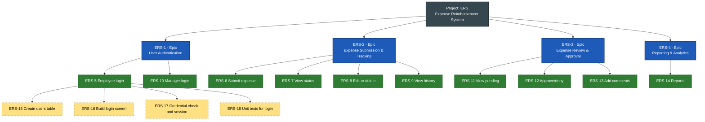

# JIRA for Beginners: Expense Tracker Demo

## What is JIRA?

JIRA is a work-tracking tool made by Atlassian that helps teams plan, track and deliver work. Every piece of work becomes an **issue** (a ticket) that moves across a board from "To Do" to "Done", so everyone can see who is doing what and how far along it is.

Teams use it for three things:

- **Plan**: break a big goal into small, estimable pieces and put them in priority order.
- **Track**: see each item's status, owner and history in one place.
- **Report**: measure progress with burndown charts, velocity and dashboards.

JIRA supports Agile methods out of the box: **Scrum** (work in fixed-length sprints) and **Kanban** (continuous flow with work-in-progress limits). In this class we use Scrum.

## Key JIRA terms

These are the words students will see on screen during the demo, grouped roughly in the order they appear.

| Term | What it means | Example from our demo |
| --- | --- | --- |
| Project | A container for all the work of one product or team. Has a short **key** used in every issue ID. | Expense Reimbursement System (key **ERS**) |
| Issue | Any single item of work tracked in JIRA. Gets an ID like ERS-12. | ERS-12: Approve or deny expense |
| Epic | A large body of work that is too big for one sprint; groups related stories. | ERS-2 Expense Submission & Tracking |
| Story (User Story) | A small feature described from the user's point of view: *As a… I want… so that…* | As an employee, I want to log in… |
| Task | Technical or non-user-facing work that still needs doing. | Set up the shared expenses database |
| Sub-task | A smaller step inside a story or task, often one per developer activity. | Build login form UI |
| Bug | Something that is broken and doesn't work as expected. | Denied expense still shows "Pending" |
| Acceptance criteria | The conditions a story must meet to be accepted as done. | Wrong password shows an error message |
| Story points | A relative estimate of effort and complexity (often 1, 2, 3, 5, 8, 13). | Login = 3 points |
| Priority | How urgent an issue is: Highest, High, Medium, Low, Lowest. | Login = Highest |
| Assignee / Reporter | Assignee does the work; reporter created the issue. | Assignee: Dev A, Reporter: Product Owner |
| Backlog | The prioritized list of all work not yet in a sprint. | All 10 stories start here |
| Sprint | A fixed time-box (usually 1–2 weeks) in which the team commits to a set of issues. | Sprint 1: Login and submit expense |
| Board | The visual view of work in columns (Scrum board or Kanban board). | To Do · In Progress · In Review · Done |
| Workflow | The set of statuses an issue moves through and the allowed transitions. | To Do → In Progress → In Review → Done |
| Status | Where an issue currently sits in the workflow. | In Progress |
| Component | A sub-part of the project used to group issues. | Employee App (Python), Manager App (Java) |
| Label | A free-text tag for filtering. | `python`, `java`, `security` |
| Velocity | Story points a team completes per sprint, on average. | 13 points per sprint |
| Burndown chart | A chart of remaining work over the days of a sprint. | Shows if Sprint 1 is on track |
| JQL | JIRA Query Language, used to search and filter issues. | `project = ERS AND status = "In Progress"` |
| Definition of Done | The team's shared checklist for calling any item complete. | Code reviewed, tested, merged |

## Issue hierarchy

JIRA work nests in levels: an epic holds stories, tasks and bugs, and each of those can hold sub-tasks.

Blue boxes are epics, green boxes are stories, and dashed yellow boxes are sub-tasks (shown for ERS-5 only).

How to read it:

- **Epic**: a big goal that spans several sprints.
- **Story, Task, Bug**: fits inside one sprint.
- **Sub-task**: one step of a story, estimated in hours.
- **Components** split the Python and Java work.

## Demo project setup

We will create one Scrum project that covers both apps, and use **components** to separate the Python and Java work.

| Setting | Value |
| --- | --- |
| Project name | Expense Reimbursement System |
| Project key | ERS |
| Template | Scrum (team-managed) |
| Components | Employee App (Python) · Manager App (Java) |
| Workflow | To Do → In Progress → In Review → Done |
| Sprint length | 2 weeks |
| Sample team | Product Owner, Scrum Master, 2 Python devs, 2 Java devs, 1 QA |

## Epics

The 10 stories group into 4 epics by **business capability**, not by app. This is a useful teaching point: an epic can span both the Python and Java apps, while components keep the code ownership clear.

| Key | Epic | Goal | Stories | Total points |
| --- | --- | --- | --- | --- |
| ERS-1 | User Authentication | Employees and managers can securely sign in to their app | ERS-5, ERS-10 | 6 |
| ERS-2 | Expense Submission & Tracking | Employees can submit, correct and follow their expenses | ERS-6, ERS-7, ERS-8, ERS-9 | 16 |
| ERS-3 | Expense Review & Approval | Managers can review, decide on and explain expense decisions | ERS-11, ERS-12, ERS-13 | 10 |
| ERS-4 | Reporting & Analytics | Managers can analyze spending trends | ERS-14 | 8 |

Alternative grouping to discuss with the class: one epic per app (Employee App, Manager App). It is simpler, but mixes unrelated features and hides the shared login work.

## User stories

Each story below is ready to type into JIRA. Points and priorities are sample values for the demo; adjust them live with the class during estimation.

| Key | Summary | Epic | Component | Points | Priority | Sprint |
| --- | --- | --- | --- | --- | --- | --- |
| ERS-5 | Employee login | ERS-1 | Employee App (Python) | 3 | Highest | Sprint 1 |
| ERS-6 | Submit new expense | ERS-2 | Employee App (Python) | 5 | High | Sprint 1 |
| ERS-7 | View expense status | ERS-2 | Employee App (Python) | 3 | High | Sprint 1 |
| ERS-8 | Edit or delete pending expense | ERS-2 | Employee App (Python) | 5 | Medium | Sprint 2 |
| ERS-9 | View expense history | ERS-2 | Employee App (Python) | 3 | Medium | Sprint 2 |
| ERS-10 | Manager login | ERS-1 | Manager App (Java) | 3 | Highest | Sprint 1 |
| ERS-11 | View pending expenses | ERS-3 | Manager App (Java) | 3 | High | Sprint 1 |
| ERS-12 | Approve or deny expense | ERS-3 | Manager App (Java) | 5 | High | Sprint 1 |
| ERS-13 | Comment on expense decision | ERS-3 | Manager App (Java) | 2 | Medium | Sprint 2 |
| ERS-14 | Generate spending reports | ERS-4 | Manager App (Java) | 8 | Low | Sprint 2 |

### Acceptance criteria

**ERS-5 Employee login.** *As an employee, I want to log in with my credentials so that I can securely access my expense reports.*

- Valid username and password opens the employee dashboard.
- Invalid credentials show "Invalid username or password" without saying which one was wrong.
- Passwords are stored hashed, never in plain text.
- An employee sees only their own expenses after login.

**ERS-6 Submit new expense.** *As an employee, I want to submit a new expense with details about amount and description so that I can request reimbursement or track spending.*

- Form requires amount and description; category and date are optional.
- Amount must be a positive number with at most 2 decimals.
- On submit the expense is saved with status **Pending** and appears in the employee's list.

**ERS-7 View expense status.** *As an employee, I want to view the status of my submitted expenses so that I know whether they are pending, approved, or denied.*

- List shows amount, description, submitted date and status for each expense.
- Status is one of Pending, Approved or Denied.
- List can be filtered by status.

**ERS-8 Edit or delete pending expense.** *As an employee, I want to edit or delete expenses that are still pending so that I can correct mistakes before they are reviewed.*

- Edit and Delete are available only when status is Pending.
- Delete asks for confirmation before removing the expense.
- Approved or denied expenses cannot be changed.

**ERS-9 View expense history.** *As an employee, I want to view a history of all my approved and denied expenses so that I can track my financial activity over time.*

- History lists approved and denied expenses, newest first.
- Each row shows the decision date and the manager's comment, if any.
- Shows total approved amount for the selected period.

**ERS-10 Manager login.** *As a manager, I want to log in securely so that I can access and manage employee expense reports.*

- Only users with the Manager role can sign in to the Manager App.
- An employee account trying to sign in is refused with a clear message.
- Session ends after a period of inactivity.

**ERS-11 View pending expenses.** *As a manager, I want to view a list of all pending expenses so that I can review them efficiently.*

- List shows every Pending expense with employee name, amount, description and date.
- List can be sorted by date or amount.
- Approved or denied expenses do not appear here.

**ERS-12 Approve or deny expense.** *As a manager, I want to approve or deny submitted expenses so that I can manage reimbursements appropriately.*

- Manager can mark a Pending expense as Approved or Denied.
- The decision, manager and date are saved with the expense.
- The employee sees the new status the next time they view their list.

**ERS-13 Comment on expense decision.** *As a manager, I want to add comments to expense decisions so that employees understand the reasoning behind approvals or denials.*

- Manager can add a comment when approving or denying.
- A comment is required when denying.
- The comment appears in the employee's history (ERS-9).

**ERS-14 Generate spending reports.** *As a manager, I want to generate reports by employee, category, or date so that I can analyze spending trends and make informed decisions.*

- Manager can filter by employee, category and date range.
- Report shows count and total amount per group.
- Report can be exported to CSV.

## Sample sub-tasks

Show students how one story breaks into hands-on work. Sub-tasks are not estimated in points; teams often track them in hours instead.

| Key | Parent story | Sub-task | Assignee | Estimate |
| --- | --- | --- | --- | --- |
| ERS-15 | ERS-5 Employee login | Create users table with hashed passwords | Python Dev A | 3h |
| ERS-16 | ERS-5 Employee login | Build login screen / CLI prompt | Python Dev B | 3h |
| ERS-17 | ERS-5 Employee login | Implement credential check and session | Python Dev A | 4h |
| ERS-18 | ERS-5 Employee login | Write unit tests for valid and invalid login | QA | 3h |
| ERS-19 | ERS-12 Approve or deny expense | Add approve/deny endpoint in Java service | Java Dev A | 4h |
| ERS-20 | ERS-12 Approve or deny expense | Add Approve and Deny buttons to manager view | Java Dev B | 3h |
| ERS-21 | ERS-12 Approve or deny expense | Test status change is visible to employee | QA | 3h |

Optional bug to log live: **ERS-22 (Bug)** — "Denied expense still shows as Pending in employee list", linked to ERS-12, priority High.

## Sprint plan and board walkthrough

Sprint 1 delivers the end-to-end core loop: log in, submit, approve or deny, see the result. Sprint 2 adds the refinements and reporting.

| Sprint | Goal | Stories | Points |
| --- | --- | --- | --- |
| Sprint 1 | An employee can submit an expense and a manager can approve or deny it | ERS-5, ERS-6, ERS-7, ERS-10, ERS-11, ERS-12 | 22 |
| Sprint 2 | Employees can correct and review expenses; managers can explain decisions and report | ERS-8, ERS-9, ERS-13, ERS-14 | 18 |

How ERS-6 (Submit new expense) moves across the board:

1. **To Do**: the story sits in Sprint 1 after sprint planning, unassigned.
2. **In Progress**: Python Dev B assigns it to themselves and drags it over; sub-tasks are worked one by one.
3. **In Review**: code is pushed and a teammate reviews it; QA tests against the acceptance criteria.
4. **Done**: all criteria pass and the Definition of Done is met. If review fails, the card goes back to In Progress.

At the end of the sprint, show the **burndown chart** and the **sprint report**, then hold a short retrospective.

## Live demo script

Free JIRA Cloud site. Menu names can differ slightly between JIRA versions.

1. **Create the project** : Projects → Create project → Scrum → team-managed. Name it Expense Reimbursement System, key ERS.
2. **Add components** : Project settings → Components → add Employee App (Python) and Manager App (Java).
3. **Create the 4 epics** : open the Timeline (or Backlog epic panel) and create ERS-1 to ERS-4. Point out each gets an ID automatically.
4. **Create the stories** : in the Backlog, create the 10 stories. Fill in one fully on screen (summary, description, acceptance criteria, epic/parent, component, priority, points), then create the rest quickly.
5. **Add sub-tasks** : open ERS-5 and add its 4 sub-tasks; assign them to show ownership.
6. **Estimate together** : ask the class to vote on points for one story to show relative sizing.
7. **Plan Sprint 1** : create a sprint, drag the 6 Sprint 1 stories in, set a goal and 2-week dates, click Start sprint.
8. **Work the board** : move ERS-6 from To Do to Done; log the sample bug ERS-22 and link it to ERS-12.
9. **Search and report** : run the JQL `project = ERS AND component = "Manager App (Java)"`, then open the burndown chart.

Class exercise: students create ERS-8 with its own acceptance criteria and 3 sub-tasks, then move it through the board.
