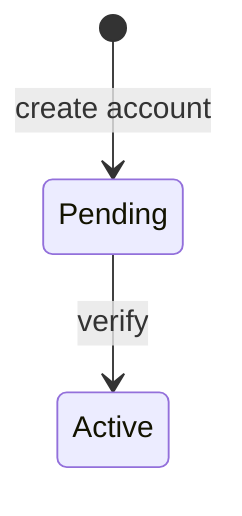

# Pair Programming Project: Test Design Techniques for Membership and Promo Codes

Week 3 - Quality Engineering Foundations | Thursday | Format: Pair Programming (Driver / Navigator) | Time: 2 h 55 min (inside the 2 to 3 hour window)

## Scenario

Your team is adding **Account Membership and Promo Codes** to Project 1. A developer finished a first version (`membership.py`) and says "it works". Your job as a pair of test designers is to prove it with a small, well-designed, runnable test suite. You will design tests with three techniques, write them as pytest code in a shared Git repository, find out what is broken, and then review another pair's work.

The module has several defects. You are not told where they are. Good test design finds them.

## Project 1 milestone for today

**Milestone 4: Pair-designed test suite v1 for Membership and Promo Codes, using three techniques (BVA with EP, Decision Table, State Transition), cross-reviewed by another pair.**
Friday builds on this suite for regression and risk planning, so keep it tidy.

## Objectives

By the end you can:
1. Choose a test design technique for a rule and justify the choice.
2. Apply Equivalence Partitioning and Boundary Value Analysis to numeric and text-length rules.
3. Build a full and a collapsed decision table and turn rules into tests.
4. Draw a state diagram, fill a state table, and test valid and invalid transitions and guards.
5. Implement designs as parametrized pytest tests with traceable test IDs and requirement IDs.
6. Work as driver and navigator, review a peer's tests with a checklist, and reflect on the process.

## Prerequisites

Thursday lessons (in `written/4-thursday/`): Black-Box Testing (sections on choosing and combining techniques, and deriving test cases from a specification), Equivalence Partitioning, Boundary Value Analysis, Decision Table Testing, State Transition Testing. Optional for the bonus: Error Guessing, Use-Case Testing.
Wednesday: the test case format (ID, requirement, steps, expected result) and traceability. Earlier this week: Git basics and running pytest.
Friday topics (white-box coverage, regression, exploratory depth, performance) are **not** needed.

## Files you receive

| Folder | Content |
|---|---|
| `templates/feature-spec-membership-promo-codes.md` | The specification with requirement IDs (MEM, PRM, DSC, ACC). Your only source of truth. |
| `starter_code/` | Starter repository: `membership.py`, `tests/test_example.py`, config files, `design/` placeholders. |
| `templates/` | Design, defect, review, retrospective and pairing-log templates. |

## Time plan and driver / navigator swap schedule

Each pair has Partner A and Partner B. Set a visible timer for every block. **Swap when the timer rings, even mid-sentence.**

| Block | Clock | Minutes | Activity | Driver | Navigator |
|---|---|---|---|---|---|
| 1 | 0:00 - 0:30 | 30 | Setup and roles (0:00-0:10), read the spec together (0:10-0:20), technique selection table (0:20-0:30) | A | B |
| 2 | 0:30 - 1:00 | 30 | BVA and EP design document, then pytest tests (swap point) | B | A |
| 3 | 1:00 - 1:30 | 30 | Decision table (full, collapsed) and tests (swap point) | A | B |
| 4 | 1:30 - 2:00 | 30 | State diagram, state table and tests (swap point) | B | A |
| 5 | 2:00 - 2:15 | 15 | Run the suite, `DEFECTS_FOUND.md`, push (swap point) | A | B |
| 6 | 2:15 - 2:40 | 25 | Cross-review of another pair (reader and writer swap at 12 minutes) | both | both |
| 7 | 2:40 - 2:55 | 15 | Retrospective | both | both |
| | | **175** | **= 2 h 55 min** | | |

Block 1 includes the 10-minute setup, so A drives for 30 minutes and every partner drives in at least two blocks.

## Roles

| | Driver | Navigator |
|---|---|---|
| Does | Types: documents, code, Git commands. Explains out loud what they are typing. | Reads the spec, thinks ahead, checks every line against requirement IDs, spots typos and missing cases, keeps the timer. |
| Do | Say your intent before typing. Ask when unsure. Accept direction from the navigator. | Give small, clear directions. Ask "why?" questions. Note ideas for later in the pairing log. Look up lesson sections. |
| Do not | Go silent. Type fast without explaining. Ignore the navigator's suggestion. | Grab the keyboard. Dictate every character. Check your phone or other work. |

Sentence starters

| Driver | Navigator |
|---|---|
| "I am going to write... because requirement ___ says..." | "Could we check the spec for ___ before we type?" |
| "I am not sure about ___. What do you think?" | "What happens at the value just below / above?" |
| "Let me run it and read the first failure aloud." | "Which requirement ID does this test cover?" |
| "Is this name clear enough for a reader?" | "I will keep the timer and note that idea for later." |

## Ground rules

1. Talk out loud. Silent typing is not pairing.
2. Switch on the timer. Commit before you swap.
3. Both partners may edit files in any block, but only the driver types in the active block. The navigator proposes changes in words.
4. Every commit message names the driver: `[driver: Priya] bva: add age boundary tests (MEM-01)`.
5. Disagree by pointing to the spec. If the spec is unclear, write the question in the design document and choose an assumption together.
6. Be kind. Critique tests and designs, never people.

## Git workflow for beginners

Use ONE repository per pair (or one branch per pair in a shared class repository, if your instructor provides it).

Partner A, once:
```bash
cp -r starter_code membership-pair-<nameA>-<nameB>
cd membership-pair-<nameA>-<nameB>
git init
git add .
git commit -m "[driver: <nameA>] chore: import starter code"
git branch -M main
git remote add origin <empty-repo-url>        # create an empty repo on GitHub or GitLab first and add Partner B
git push -u origin main
git checkout -b pair-<nameA>-<nameB>
git push -u origin pair-<nameA>-<nameB>
```
Partner B, once (and again if working on another machine):
```bash
git clone <repo-url>
cd <repo-folder>
git checkout pair-<nameA>-<nameB>
```
Shared cohort repository variant: `git clone <class-repo-url>`, then `git checkout -b pair-<nameA>-<nameB>`, and add your files in a folder with your pair name.

Every swap:
```bash
git status
git add design/ tests/                      # name what you add; avoid "git add ." after your first import
git commit -m "[driver: <name>] <area>: <what> (<req IDs>)"
git push
# the new driver, on the other machine:
git pull
```
Optional: open a pull request from `pair-<nameA>-<nameB>` to `main` on the hosting site. The cross-review can be written as PR comments.

Commit message examples: `[driver: Sam] dt: full 16-rule decision table (DSC-01..06)`, `[driver: Priya] st: invalid transition tests (ACC-06)`.
Do not commit `.venv/`, `__pycache__/` or any passwords or tokens: the provided `.gitignore` covers the common cases. Do not edit `membership.py` on your branch (see task 4).

## Tasks

### Task 1 - Read the spec and choose techniques (Block 1)
Read `feature-spec-membership-promo-codes.md` together, then fill `design/technique-selection-table.md`. For each rule or field say which technique you choose and why, and which one you rejected. Do this BEFORE writing tests.

### Task 2 - Design with at least three techniques (Blocks 2 to 4)
Required documents in `design/`:

| File | Technique | Must contain |
|---|---|---|
| `bva-ep-design.md` | EP + BVA | Partitions (valid and invalid) for age, student flag and promo code; boundary values for age (16-65) and promo length (6-10); your 2-value or 3-value convention. |
| `decision-table.md` | Decision table | Conditions and actions; the **full** table with 2^n rules; the **collapsed** table; mapping to tests. |
| `state-transition-design.md` | State transition | Mermaid state diagram (start from `templates/state-diagram-template.mermaid`); state table for every state and event; list of valid and invalid transitions and guards. |

Optional fourth technique (bonus): error guessing (write 5 or more "what would a careless user or developer do" ideas) and a use-case scenario of "sign up, verify, buy with promo".

Mermaid skeleton to start from:


### Task 3 - Implement as pytest tests (Blocks 2 to 4)
In `tests/`, create `test_bva_ep.py`, `test_decision_table.py`, `test_state_transition.py` (and `test_error_guessing.py` if you do the bonus).
- Use `pytest.mark.parametrize` with `pytest.param(..., id="...")`.
- Test ID format: `<TECH>-<AREA>-<NN>-<meaning>`, for example `BVA-AGE-02-16-min`, `DT-DSC-05-TFTT`, `ST-INV-03-active-verify`.
- Cite requirement IDs in each test's docstring.
- Expected values come from the spec, never from running the code and copying the output.
- Look at `tests/test_example.py` for the format. It uses the large-order threshold, which is not one of your required fields.

### Task 4 - Run, find defects, suggest fixes (Block 5)
Run `pytest`. Some tests will fail: that is the point. For every failing test fill a row in `DEFECTS_FOUND.md`: test ID, requirement, observed vs expected, technique that found it, a suggested fix. Group tests that fail for the same cause into one defect. Do not change `membership.py` in your main branch. To try a fix, copy it to a file outside `tests/` (for example `membership_fix_try.py`) or just describe the fix in words. If a test fails and you believe the TEST is wrong, re-read the spec and fix the test.

### Task 5 - Cross-review (Block 6)
Swap repository links with another pair (your instructor names the pairs). Using `templates/review-checklist.md`, review their design documents and tests. One partner reads and one writes; swap after 12 minutes. Write **at least 5 specific comments** (at least 2 strengths and 3 improvements) in `REVIEW_COMMENTS.md` in YOUR repo (or as PR comments on theirs, then paste links). Then spend a few minutes talking with the authors.

### Task 6 - Retrospective (Block 7)
Fill `RETROSPECTIVE.md`: what went well, what did not, actions; Start-Stop-Continue; one learning about pairing; each person rates the driver and navigator experience 1 to 5 with one sentence.

## Deliverables

Repository (or branch) named `membership-pair-<nameA>-<nameB>` / `pair-<nameA>-<nameB>` containing:

| Path | Content |
|---|---|
| `design/technique-selection-table.md` | Task 1 |
| `design/bva-ep-design.md`, `design/decision-table.md`, `design/state-transition-design.md` | Task 2 |
| `tests/test_bva_ep.py`, `tests/test_decision_table.py`, `tests/test_state_transition.py` (+ optional `tests/test_error_guessing.py`) | Task 3 |
| `DEFECTS_FOUND.md` | Task 4 |
| `REVIEW_COMMENTS.md` | Task 5 |
| `RETROSPECTIVE.md` | Task 6 |
| `PAIRING_LOG.md` | From `templates/pairing-log-template.md` |

## Definition of Done (checkable)

- [ ] `design/technique-selection-table.md` covers every requirement ID (MEM, PRM, DSC, ACC) at least once.
- [ ] BVA table lists all boundary values for each range (age and promo length) under your stated convention, and EP lists valid and invalid partitions for every input field.
- [ ] Decision table has 2^n rules before collapse (n = number of conditions) and a collapsed version whose merged rules share the same action.
- [ ] State diagram shows 4 states and all events; state table has one cell for each of the 16 state-event pairs.
- [ ] State tests cover all valid transitions and at least 3 invalid transitions, plus both guards.
- [ ] Every test has a readable ID and a requirement ID in its docstring; no duplicate tests.
- [ ] `pytest` runs without errors in a fresh clone (failures are allowed only where a defect is exposed).
- [ ] `DEFECTS_FOUND.md` lists at least 4 of the 6 planted defects, each with a failing test ID and a fix suggestion.
- [ ] `REVIEW_COMMENTS.md` has at least 5 specific comments about another pair's work.
- [ ] `RETROSPECTIVE.md` is complete, including both ratings.
- [ ] Commit history shows both partners drove in at least 3 blocks, and commit messages name the driver.

## Grading rubric (100 points)

| Area | Points | Excellent looks like |
|---|---|---|
| Technique selection table | 8 | Each choice is justified by the nature of the rule; a rejected alternative is named. |
| BVA and EP design | 12 | Complete partitions, all boundaries, convention stated, expected results from the spec. |
| Decision table | 12 | 2^n full table, correct collapse, clear mapping from rules to tests. |
| State transition design | 12 | Accurate diagram, complete state table, invalid transitions and guards identified. |
| pytest implementation | 14 | Parametrized, readable IDs, traceable requirement IDs, independent tests, no copied-from-code expectations. |
| Defects-found log | 10 | Failing tests mapped to defects and requirements, sensible fix suggestions, honest about misses. |
| Cross-review | 10 | 5 or more specific, kind, actionable comments that use the checklist. |
| Retrospective | 5 | Honest, specific actions, ratings with reasons. |
| Collaboration and process | 12 | Roles alternate on time, both drive, driver named in commits, pairing log filled, balanced talking. |
| Repository hygiene and traceability | 5 | `.gitignore` respected, clean structure, requirement IDs consistent across documents and tests. |

## Hints (no answers)

- Ranges first: write the number line, mark where valid starts and ends, then look at each side of each edge.
- An input can be wrong in more than one way: out of range is not the same as the wrong type.
- Write the conditions of the discount rule first and count them; the full table size follows from that count.
- When you collapse a table, ask what a "-" really means. If your test picks a value for a "-", could a defect hide behind the value you did not pick?
- Draw all four states, then check every state against every event, including the ones the spec says are refused.
- A guard has two outcomes. Test both, and test it in every state where it applies.
- Ask what careless users do with text boxes (copy and paste habits, capitals).
- Re-run only one test: `pytest -k "BVA-AGE"`.

## Common mistakes

- Writing tests before choosing techniques, which leads to random examples.
- Copying expected values from what the code returns, so the test can never fail.
- Testing boundaries only on one side, or testing a range with only one valid value.
- Changing several inputs at once, so a failure cannot be traced to one cause.
- Skipping the invalid transitions because "the user can never do that".
- Collapsing a decision table by guesswork instead of by comparing actions.
- Navigator takes over the keyboard, or driver stops explaining.
- Committing without saying who drove, or never pushing before a swap.

## Stretch goals

- Add the optional fourth technique: error guessing tests in `tests/test_error_guessing.py`.
- Write one use-case scenario test: create account, verify, order with a promo code.
- Add a pairwise (all-pairs) view of the four discount conditions and discuss what it would miss.
- Add a coverage summary table: requirement ID by test IDs.

## Optional: using an AI assistant

You may ask an AI assistant to **critique** your finished design (not to write it). Examples: "Here is my BVA table for an age range 16-65. Which boundary values might I be missing?" "Here is my collapsed decision table; find rules that merge incorrectly."
Verify every suggestion: Does it cite a requirement ID? Does it match the spec text exactly (an assistant may invent rules)? Can you explain it to your partner in your own words? Record in your retrospective what you accepted, what you rejected, and why. Do not paste secrets into any tool.

## Submission

Share the repository link and the branch name with your instructor (and with the reviewing pair). Make sure the repository is readable by them, and that no passwords, tokens or personal data are committed. Submit before the end of the session; the retrospective is part of the submission.

## What comes next

On Friday you extend this suite: you will use it for regression planning and risk-based prioritization, so keep test IDs and requirement IDs consistent.
