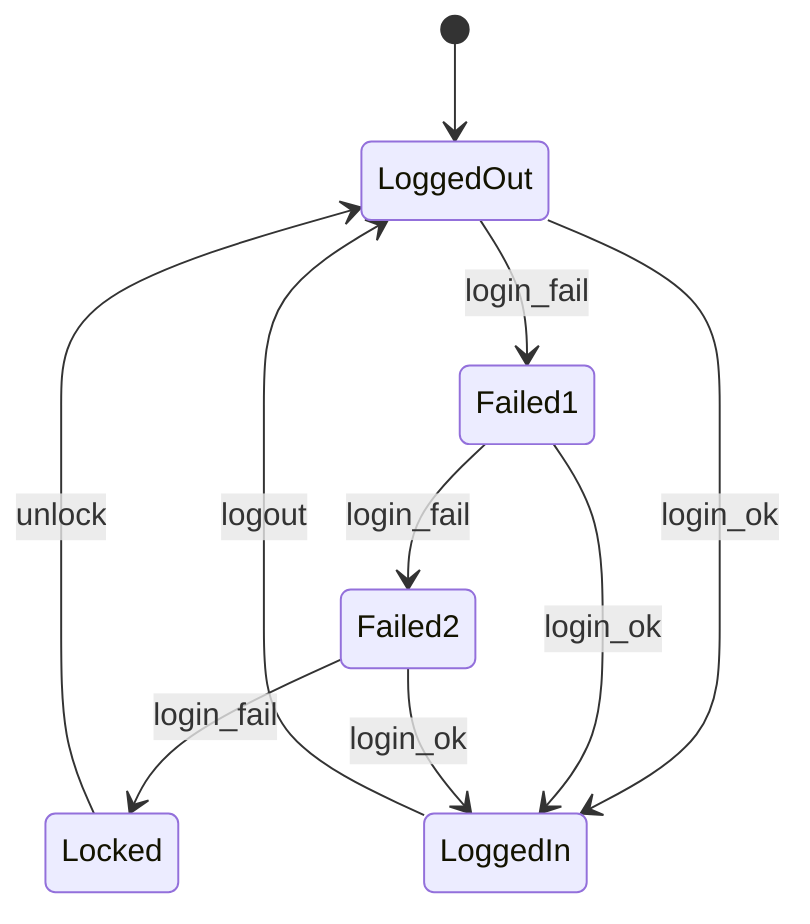

# State Transition Testing

## Learning Objectives

By the end of this lesson you will be able to:

- Explain when the behavior of a system depends on its history, and recognize "same input, different result" situations.
- Define and correctly use the key terms: state, event (trigger), transition, action (output), guard condition, initial state, and final state.
- Read a state transition diagram and build one from a written requirement, step by step.
- Build a state transition table (a state-by-event matrix) that shows both valid and invalid transitions.
- Explain and calculate four coverage levels: all states, valid transitions (0-switch), invalid transitions (state table coverage), and N-switch (1-switch) coverage.
- Design test cases as sequences of events that start at the initial state and cover every transition in as few paths as possible.
- Write test cases in the standard format: start state, event/input, expected output, expected end state.
- Use state tables to discover gaps and ambiguities in requirements.
- Compare state transition testing with decision table testing and use case testing, and combine it with boundary value analysis and error guessing.
- Implement a small state machine in Python, test it with pytest, and use an invalid-transition test to catch a deliberate defect.
- Choose the right test design technique for a given type of feature.

## Why This Matters

Earlier today you learned several black-box techniques. Equivalence Partitioning and Boundary Value Analysis help you choose good input values. Decision tables help you test combinations of conditions. Use case testing helps you walk through user goals. Each of these answers a different question.

None of them directly answers this one: "What happens when the system behaves differently depending on what has already happened?"

Think about the Project 1 login page. Typing the wrong password once shows an error message. Typing the wrong password a third time locks the account. The input is identical, but the result is not. The difference is not in the input. It is in the system's memory of earlier events. Equivalence partitioning cannot see this. A decision table with the conditions "password correct / incorrect" cannot see it either. You need a technique that treats "where the system currently is" as part of the test.

That technique is state transition testing. It matters in real projects because a huge number of defects hide in state handling:

- A locked account that still accepts the correct password.
- An order that can be cancelled after it has shipped.
- A bug that can be moved from New straight to Closed, skipping the fix and the retest.
- A password reset link that still works after it has been used.

These are not input problems. They are state problems, and they tend to be serious (security, money, data integrity). They are also easy to miss with casual testing, because testers usually try the "happy" route and forget to try events in the wrong state. State transition testing gives you a systematic way to try them all.

This technique is also a gentle bridge to automation. A state machine can be written as a small table in code (you will do that later in this lesson), and tests that walk through it are easy to automate.

## The Concept

### 1. A system that remembers where it is

Picture a traffic light. It has no sensor for "what the previous color was", yet it always knows what comes next. After red comes green, after green comes yellow, after yellow comes red. The light "remembers" its current color, and that memory decides what happens when the timer fires.

Now picture a subway turnstile. If you push the arm while it is locked, nothing happens. If you insert a coin first and then push, you walk through. The push is the same action both times. The result differs because the turnstile was in a different condition.

A system like this is called a finite state machine: it can be in exactly one of a limited (finite) number of conditions at any time, and events move it from one condition to another.

The golden rule of this lesson:

> **If the same input can produce different results depending on what happened before, the system is state-dependent, and you should consider state transition testing.**

### 2. Where state-dependent behavior shows up

| System | Same input | Result depends on state |
|---|---|---|
| ATM | Enter a PIN | First wrong PIN: "try again". Third wrong PIN: card retained. |
| Account lock | Enter a wrong password | 1st or 2nd time: error message. 3rd time: account locked. |
| Order status | Click "Cancel order" | Before shipping: cancelled and refunded. After shipping: not allowed. |
| Video player | Press the play/pause button | Playing: it pauses. Paused: it plays. |
| Traffic light | Timer expires | Red: becomes green. Green: becomes yellow. |
| Turnstile | Push the arm | Locked: stays locked. Unlocked: lets you through, then locks. |
| Login session | Open a protected page | Logged in: page shown. Logged out or session expired: redirected to login. |
| Ticket workflow | Click "Close" | After a verified fix: closes. Straight after creation: should not be allowed. |

Whenever you hear words like "only after", "until", "once", "if it has already", "the third time", "locked", "expired", or "status", your state detector should light up.

### 3. The vocabulary

Every term below will be used throughout the lesson. Learn them well.

**State.** A stable condition of the system at a point in time, during which it waits for the next event. States are usually named with nouns or adjectives: Logged Out, Locked, Paid, Playing. A state summarizes relevant history: "Failed 2 times" is a state that remembers two earlier failures without storing every detail.

**Event (also called trigger or input).** Something that happens and may cause the system to react: the user clicks a button, a timer expires, a message arrives, a payment is confirmed. Events are usually named with verbs: login_fail, pay, ship, cancel.

**Transition.** The movement from one state to another, caused by an event. A transition is written as: current state, event, next state. For example: (Failed 2 Times) + login_fail = (Locked).

**Action (also called output).** What the system does or shows when a transition happens: displays a message, sends an email, charges a card, writes to a log. An action is the visible or measurable result. Expected output in a test case usually comes from here.

**Guard condition.** A true/false condition that must be satisfied for a transition to happen. It is written in square brackets. Example: `return_request [within 30 days of delivery]`. If the guard is false, the transition does not fire. The same event can have two transitions from the same state, separated by guards (for example, `select_item [credit >= price]` and `select_item [credit < price]`).

**Initial state.** The state where the system starts. A diagram has exactly one, shown with a filled dot or an arrow from nowhere. In our ASCII diagrams it is marked `(*)`. Every test path starts here (or in a state you deliberately set up).

**Final state.** A state from which the system does not move further (a "dead end" by design). Examples: Cancelled, Delivered and closed for good, Published. Not every system has one. A turnstile or login page runs forever and has no final state.

**Valid transition.** A transition the requirements define: the event is allowed in this state.

**Invalid transition.** An event that the requirements do not allow in this state. In a state table these cells are marked "null" or "invalid". Testing means proving the system refuses or ignores the event and stays in a sensible state.

**Self-transition (loop).** A transition that returns to the same state (for example, pushing a locked turnstile keeps it locked). It is still a transition and it still needs a test.

A compact notation you will see often is:

```
Event [guard] / action
```

Read it as: "When this event happens, if the guard is true, do this action." Guard and action are optional.

### 4. The state transition diagram

A state transition diagram shows states as boxes (or circles) and transitions as arrows labeled with the event (and sometimes guard and action).

**Example A: the turnstile (two states).**

```
 (*)
  |
  v
+--------+   coin / arm unlocks   +----------+
| LOCKED |----------------------->| UNLOCKED |
|        |<-----------------------|          |
+--------+   push / arm locks     +----------+
 ^      |                          ^       |
 +------+                          +-------+
 push / nothing happens           coin / coin returned
```

How to read it, in words:

- The turnstile starts LOCKED (the `(*)` arrow).
- In LOCKED, a coin moves it to UNLOCKED and the arm unlocks.
- In LOCKED, a push keeps it LOCKED and nothing happens (a self-transition).
- In UNLOCKED, a push lets the person through and the arm locks again, so it returns to LOCKED.
- In UNLOCKED, another coin changes nothing: the coin is returned and it stays UNLOCKED (a self-transition).

There are 2 states, 2 events, and 4 transitions. Every cell in the state table is defined, so this system has no "invalid" cells; it chooses to handle every event everywhere. Many real systems do not.

**Example B: the traffic light (three states, one event).**

```
 (*)
  |
  v
+-------+  timer   +-------+  timer   +--------+
|  RED  |--------->| GREEN |--------->| YELLOW |
+-------+          +-------+          +--------+
    ^                                      |
    |               timer                  |
    +--------------------------------------+
```

There is only one event (the timer), yet the result depends entirely on the state: red leads to green, green to yellow, yellow to red. This is the cleanest possible example of "same event, different result."

### 5. The state transition table

A diagram is easy to read but easy to be incomplete in. It only shows the arrows that exist. It hides what is missing. A state transition table fixes this by listing every combination of state and event.

The table has one row per state and one column per event. Each cell holds the next state (and optionally the action), or the word `invalid` (some teams write `null` or a dash) if the event is not allowed there.

Turnstile as a table:

| Current state | coin | push |
|---|---|---|
| LOCKED | UNLOCKED (arm unlocks) | LOCKED (nothing) |
| UNLOCKED | UNLOCKED (coin returned) | LOCKED (person passes) |

Traffic light as a table:

| Current state | timer |
|---|---|
| RED | GREEN |
| GREEN | YELLOW |
| YELLOW | RED |

The most important property of the table: **it forces you to look at every cell**. A blank cell is a question: "What should happen here?" If the requirement does not say, you have found a gap. This is the table's greatest value, which we return to in a later section.

The number of cells equals states times events. Turnstile: 2 x 2 = 4. A system with 5 states and 4 events has 20 cells, and you must decide what each one does.

### 6. Reading a diagram: a short checklist

When someone hands you a diagram:

1. Find the initial state (the arrow from nowhere). That is where every test begins.
2. List the states. Count them.
3. List the events (all different arrow labels).
4. Count the arrows. These are the valid transitions.
5. For each state, ask: "Which events have no arrow here?" Those are the invalid transitions.
6. Look for dead ends (final states) and for states with no way in (unreachable states, which are a design smell).
7. Look for guards and actions on arrows. Each guard needs a test for both true and false.

### 7. Building a diagram from requirements, step by step

Requirements are usually written in sentences. Turning them into a diagram is a skill. Here is the process, using the Project 1 login requirements.

**Requirement text (assumed for the lesson):**

- R1. The login page is shown to a user who is not logged in.
- R2. A correct username and password logs the user in.
- R3. A wrong password shows an error message and increases the failed-attempt counter.
- R4. After 3 consecutive failed attempts the account is locked.
- R5. A successful login resets the failed-attempt counter to zero.
- R6. A locked account cannot log in, even with the correct password, until it is unlocked by an administrator or the lockout time expires.
- R7. A logged-in user can log out.

**Step 1: Underline the states (nouns and conditions).** Not logged in, logged in, locked. The counter adds more: "failed once", "failed twice". So: Logged Out, Failed 1, Failed 2, Locked, Logged In.

**Step 2: Underline the events (verbs).** Correct login, wrong login, unlock (admin or timer), log out. Name them: login_ok, login_fail, unlock, logout.

**Step 3: Choose the initial state and any final states.** The user starts Logged Out. There is no final state (the system runs on).

**Step 4: List the transitions one by one from the sentences.** Each sentence yields one or more rows of (state, event, next state):

| Req | From | Event | To |
|---|---|---|---|
| R3 | Logged Out | login_fail | Failed 1 |
| R3 | Failed 1 | login_fail | Failed 2 |
| R4 | Failed 2 | login_fail | Locked |
| R2 | Logged Out | login_ok | Logged In |
| R2, R5 | Failed 1 | login_ok | Logged In (counter reset) |
| R2, R5 | Failed 2 | login_ok | Logged In (counter reset) |
| R6 | Locked | unlock | Logged Out |
| R7 | Logged In | logout | Logged Out |

**Step 5: Note guards and actions.** Guard: the lock happens when the counter reaches 3 (we modeled it as separate states instead). Actions: show error message, show "account locked", reset counter, create session.

**Step 6: Draw it.** Place the initial state first, then follow the main path, then add the side paths.

**Step 7: Build the state table and look at the empty cells.** Ask the "what if" for each one.

**Step 8: Review with the requirement owner.** Take the questions you found to the business analyst or developer. Good questions at this step are worth more than many test cases.

### 8. Valid and invalid transitions, again

A **valid transition** is one the requirement describes. Your positive tests exercise these. An **invalid transition** is a combination of state and event the requirement does not describe, or explicitly forbids.

For invalid transitions, "expected result" is not always obvious. The system might:

- Ignore the event silently (the state does not change).
- Show an error message.
- Disable or hide the control that would trigger the event (common in UIs).
- Return an error code (common in APIs).

Whichever the requirement chooses, there is one thing that should almost never change: **the system must not move into some other state by accident.** An invalid event in the Locked state must leave the account Locked. When you test an invalid transition, you check both the response and that the state is unchanged.

This connects directly to Wednesday's lesson on negative testing: invalid transitions are negative tests for state-dependent behavior.

### 9. Test coverage levels

"Coverage" answers the question "How much of the model have my tests exercised?" State transition testing offers several levels, from lightest to heaviest. Each level includes more tests and finds more problems.

We will use the login model with these counts:

- 5 states: Logged Out, Failed 1, Failed 2, Locked, Logged In.
- 4 events: login_fail, login_ok, unlock, logout.
- 20 cells in the state table (5 x 4).
- 8 valid transitions.
- 12 invalid transitions (20 - 8).

It helps to give the 8 valid transitions short names (we will reuse these):

| ID | Transition |
|---|---|
| T1 | Logged Out --login_fail--> Failed 1 |
| T2 | Logged Out --login_ok--> Logged In |
| T3 | Failed 1 --login_fail--> Failed 2 |
| T4 | Failed 1 --login_ok--> Logged In |
| T5 | Failed 2 --login_fail--> Locked |
| T6 | Failed 2 --login_ok--> Logged In |
| T7 | Locked --unlock--> Logged Out |
| T8 | Logged In --logout--> Logged Out |

#### Level 1: All states coverage

Every state is visited at least once.

```
All states coverage % = (states visited by tests / total states) x 100
```

Example: one test path, login_fail, login_fail, login_fail, visits Logged Out, Failed 1, Failed 2, Locked. That is 4 of 5 states: 4/5 = 80%. Add one path that does login_ok and we visit Logged In too: 5/5 = 100%.

This is the weakest level. You can visit every state and still never use half of the arrows. Treat it as a minimum, not a goal.

#### Level 2: Valid transitions coverage (0-switch, "all transitions")

Every valid transition is exercised at least once. This is the standard level most projects aim for, and the one you will use most often.

```
Valid transition coverage % = (valid transitions executed / total valid transitions) x 100
```

Example: after the path login_fail, login_fail, login_fail, unlock we have executed T1, T3, T5, T7 = 4 of 8 = 50%. After adding the paths in the next section we reach 8 of 8 = 100%.

Why "0-switch"? A "switch" is a link between two consecutive transitions. A 0-switch test has zero links: it looks at each transition on its own. All transitions coverage is 0-switch coverage. Note that 100% valid transitions coverage automatically gives 100% all states coverage (if every state is reachable by some transition), so it is the stronger level.

#### Level 3: Invalid transitions coverage (state table coverage, "negative" coverage)

Every invalid cell in the state table is tried at least once, checking the system refuses it and stays in the right state.

```
Invalid transition coverage % = (invalid cells tested / total invalid cells) x 100
```

For login: 12 invalid cells. If you test only the 3 you thought of (for example Locked + login_ok, Logged In + logout twice, Logged Out + unlock), you have 3/12 = 25%.

If you test all 20 cells (8 valid and 12 invalid), you have "full state table coverage": 20/20 = 100%. Some books use "state table coverage" for exactly that: every cell, valid or not.

```
State table coverage % = (cells tested / total cells) x 100
```

#### Level 4: N-switch coverage (sequences of transitions)

A defect sometimes appears only after a specific sequence. For example, a counter that is not reset by logout shows up only on the path: fail, ok, logout, fail, fail. The fault is in the link between transitions, not in any single one.

An N-switch covers sequences of N+1 consecutive transitions:

- 0-switch: sequences of 1 transition (all transitions).
- 1-switch: sequences of 2 consecutive transitions (also called "switch of length 2").
- 2-switch: sequences of 3 consecutive transitions, and so on.

```
N-switch coverage % = (distinct sequences of N+1 transitions executed / total possible valid sequences of N+1 transitions) x 100
```

**How to count the 1-switch sequences.** For each state, multiply (the number of valid transitions coming in) by (the number going out). Add up the results.

| State | Transitions in | In | Transitions out | Out | In x Out |
|---|---|---|---|---|---|
| Logged Out | T7, T8 | 2 | T1, T2 | 2 | 4 |
| Failed 1 | T1 | 1 | T3, T4 | 2 | 2 |
| Failed 2 | T3 | 1 | T5, T6 | 2 | 2 |
| Locked | T5 | 1 | T7 | 1 | 1 |
| Logged In | T2, T4, T6 | 3 | T8 | 1 | 3 |
| **Total** | | | | | **12** |

So the login model has 12 possible 1-switch sequences: T7T1, T7T2, T8T1, T8T2, T1T3, T1T4, T3T5, T3T6, T5T7, T2T8, T4T8, T6T8.

If we ran four short test paths (T1T3T5T7, T2T8, T1T4T8, T1T3T6T8), we cover these pairs: T1T3, T3T5, T5T7, T2T8, T1T4, T4T8, T3T6, T6T8 = 8 of 12 = 66.7% 1-switch coverage, even though we have 100% of single transitions. The four missing pairs are all the "come back to Logged Out and then continue" pairs (T7T1, T7T2, T8T1, T8T2). These are exactly where a "counter not reset" defect would hide.

Closing the gap needs longer paths that continue after returning to Logged Out. Two such paths reach 12 of 12 (shown in worked example 1).

**How deep should you go?** N-switch grows quickly. Use this rule of thumb:

| Risk | Suggested level |
|---|---|
| Low (a help-tab toggle) | All states |
| Normal | Valid transitions (0-switch) plus the important invalid transitions |
| High (payments, security, medical) | 0-switch, full invalid coverage, and 1-switch on the critical areas |
| Safety critical | Higher N-switch, formally agreed with the stakeholders |

### 10. Designing test cases as event sequences

A state transition test case is not a single input. It is a sequence of events that walks the system through a path in the diagram, checking after each step that the output and the new state are correct.

Rules for building paths:

1. **Start at the initial state.** (Or, if starting elsewhere, include the steps needed to get to the required starting state. Do not assume it.)
2. **Each step is one event.** After it, you know the state you should be in.
3. **Check output and end state after every step**, not just at the end of the path. A defect in the middle of a path can be masked later.
4. **Cover all transitions in as few paths as you reasonably can.** Few paths means few setups. But do not stretch it to the point where a failure tells you nothing; a 40-step path that fails at step 31 is hard to debug.
5. **Test invalid transitions separately.** Each invalid transition test is short: reach the state (using a known path), fire the unwanted event, check the refusal and that the state is unchanged. Combining invalid events in one long path is risky because the first failure may corrupt the state for the rest.

A practical method to find the minimum paths: mark each valid transition you still need. Pick the longest path that covers many unmarked transitions. Repeat until all are marked. A test path ends when it reaches a final state, returns to the initial state, or cannot cover anything new.

### 11. The test case table format

Write each step as a row. The four essential columns are:

| Step | Start state | Event / input | Expected output | Expected end state |
|---|---|---|---|---|

The end state of one row is the start state of the next row. Write test case IDs, preconditions and requirement references around this table as your team's template demands.

Why write the start state separately? Because the same event produces different outputs in different states. The start state is part of the test input. Leaving it out is one of the most common mistakes (see "Common Mistakes").

## Examples

### Worked Example 1: Project 1 login with a failed-attempt counter

**The model.** We already built this. Here it is in full.

**State transition diagram (ASCII).** T-numbers match the table in section 9.

```
   (*)
    |
    v
+------------+  T1   +----------+  T3   +----------+  T5   +--------+
| LOGGED_OUT |------>| FAILED_1 |------>| FAILED_2 |------>| LOCKED |
+------------+       +----------+       +----------+       +--------+
 ^    |                   |                   |               |
 |    | T2                | T4                | T6            | T7 unlock
 |    v                   v                   v               |
 | +----------------------------------------------+           |
 | |                  LOGGED_IN                   |           |
 | +----------------------------------------------+           |
 |                        |                                   |
 |                        | T8 logout                         |
 +-------------------------+-----------------------------------+
```

Read the arrows:

- T1, T3, T5 (all labeled login_fail): the failure chain from Logged Out to Locked.
- T2, T4, T6 (all labeled login_ok): a correct login from Logged Out, Failed 1, or Failed 2 leads to Logged In. Because Logged In returns to Logged Out on logout, and Logged Out has a counter of zero, a successful login resets the counter.
- T7 unlock: from Locked back to Logged Out (administrator action or lockout timer; the requirement says either).
- T8 logout: from Logged In back to Logged Out.

**Optional Mermaid version** (many tools, including GitHub and some Jira add-ons, can render this):



**State transition table.** 5 states x 4 events = 20 cells; 8 valid, 12 invalid.

| Current state | login_fail | login_ok | unlock | logout |
|---|---|---|---|---|
| LOGGED_OUT | FAILED_1 (error: 2 attempts left) | LOGGED_IN (session created) | invalid | invalid |
| FAILED_1 | FAILED_2 (error: 1 attempt left) | LOGGED_IN (counter reset) | invalid | invalid |
| FAILED_2 | LOCKED (message: account locked) | LOGGED_IN (counter reset) | invalid | invalid |
| LOCKED | invalid (stays locked) | invalid (stays locked, correct password refused) | LOGGED_OUT (counter reset) | invalid |
| LOGGED_IN | invalid | invalid | invalid | LOGGED_OUT (session ended) |

**Valid transition test paths (100% 0-switch).**

Four paths cover all 8 valid transitions:

| Path | Event sequence | Transitions covered |
|---|---|---|
| A | login_fail, login_fail, login_fail, unlock | T1, T3, T5, T7 |
| B | login_ok, logout | T2, T8 |
| C | login_fail, login_ok, logout | T1, T4, T8 |
| D | login_fail, login_fail, login_ok, logout | T1, T3, T6, T8 |

Union: T1, T2, T3, T4, T5, T6, T7, T8. That is 8 of 8 = 100%.

(Joining paths can reduce this to three: path A could continue with login_ok and logout, which covers T2 and T8 and makes path B unnecessary. We keep them separate because short paths are easier to debug.)

Now the test cases in the standard format (assumed messages; adapt to the real requirement):

**TC-L1 (Path A): three failures lock the account, unlock restores access**

| Step | Start state | Event / input | Expected output | Expected end state |
|---|---|---|---|---|
| 1 | LOGGED_OUT | Enter valid username, wrong password, submit | Error "Invalid credentials. 2 attempts remaining" | FAILED_1 |
| 2 | FAILED_1 | Wrong password again | Error "Invalid credentials. 1 attempt remaining" | FAILED_2 |
| 3 | FAILED_2 | Wrong password a third time | Message "Account locked" | LOCKED |
| 4 | LOCKED | Administrator unlocks (or lockout time expires) | Login page available, counter zero | LOGGED_OUT |

**TC-L2 (Path B): direct successful login and logout**

| Step | Start state | Event / input | Expected output | Expected end state |
|---|---|---|---|---|
| 1 | LOGGED_OUT | Correct username and password | Dashboard shown | LOGGED_IN |
| 2 | LOGGED_IN | Click Logout | Login page shown | LOGGED_OUT |

**TC-L3 (Path C): one failure, then success, then logout**

| Step | Start state | Event / input | Expected output | Expected end state |
|---|---|---|---|---|
| 1 | LOGGED_OUT | Wrong password | Error "2 attempts remaining" | FAILED_1 |
| 2 | FAILED_1 | Correct password | Dashboard shown | LOGGED_IN |
| 3 | LOGGED_IN | Logout | Login page shown | LOGGED_OUT |

**TC-L4 (Path D): two failures, then success, then logout**

| Step | Start state | Event / input | Expected output | Expected end state |
|---|---|---|---|---|
| 1 | LOGGED_OUT | Wrong password | Error "2 attempts remaining" | FAILED_1 |
| 2 | FAILED_1 | Wrong password | Error "1 attempt remaining" | FAILED_2 |
| 3 | FAILED_2 | Correct password | Dashboard shown | LOGGED_IN |
| 4 | LOGGED_IN | Logout | Login page shown | LOGGED_OUT |

**Reset check (1-switch): "a successful login resets the counter" (requirement R5).**
This is the most important behavior that Level 2 coverage alone does not prove. To prove it, follow a success with new failures. Path C then two more fails shows that the counter began again from zero.

**TC-L5 (reset proof)**

| Step | Start state | Event / input | Expected output | Expected end state |
|---|---|---|---|---|
| 1 | LOGGED_OUT | Wrong password | "2 attempts remaining" | FAILED_1 |
| 2 | FAILED_1 | Wrong password | "1 attempt remaining" | FAILED_2 |
| 3 | FAILED_2 | Correct password | Dashboard | LOGGED_IN |
| 4 | LOGGED_IN | Logout | Login page | LOGGED_OUT |
| 5 | LOGGED_OUT | Wrong password | "2 attempts remaining" (NOT "locked", NOT "0 remaining") | FAILED_1 |

If step 5 says "1 attempt remaining", the counter was not reset by the earlier success. That would be a defect found only by a sequence test.

**Full 1-switch coverage with two long paths.**

| Path | Event sequence | New pairs covered |
|---|---|---|
| E | fail, fail, fail, unlock, fail, ok, logout, fail, fail, ok, logout, ok, logout | T1T3, T3T5, T5T7, T7T1, T1T4, T4T8, T8T1, T3T6, T6T8, T8T2, T2T8 (11 pairs) |
| F | fail, fail, fail, unlock, ok | T7T2 (the 12th pair; also repeats T1T3, T3T5, T5T7) |

11 + 1 = 12 of 12 = 100% 1-switch coverage. Notice that these long paths are harder to read and debug, so use them selectively (for example, in automated regression runs) and keep your manual tests short.

**Invalid transition tests (12 of 12).**

For each, reach the state with the shortest known path, fire the event, and check both the response and that the state is unchanged.

| ID | Start state (how to reach it) | Event / input | Expected output | Expected end state |
|---|---|---|---|---|
| IT1 | LOGGED_OUT (fresh start) | unlock | Not available or no effect; no error page | LOGGED_OUT |
| IT2 | LOGGED_OUT | logout | No logout option, or no effect | LOGGED_OUT |
| IT3 | FAILED_1 (1 wrong attempt) | unlock | No effect | FAILED_1 |
| IT4 | FAILED_1 | logout | No effect | FAILED_1 |
| IT5 | FAILED_2 (2 wrong attempts) | unlock | No effect (counter must not be reset by a stray unlock) | FAILED_2 |
| IT6 | FAILED_2 | logout | No effect | FAILED_2 |
| IT7 | LOCKED (3 wrong attempts) | login_fail (4th wrong attempt) | "Account locked"; no counter growth, no extension surprises | LOCKED |
| IT8 | LOCKED | login_ok (correct password) | "Account locked"; NO session, NO dashboard | LOCKED |
| IT9 | LOCKED | logout | No effect | LOCKED |
| IT10 | LOGGED_IN (correct login) | login_fail (submit the login form with a wrong password, for example via a second tab or API) | Rejected; existing session unaffected | LOGGED_IN |
| IT11 | LOGGED_IN | login_ok (log in again) | Rejected or session reused; no second conflicting session | LOGGED_IN |
| IT12 | LOGGED_IN | unlock | No effect | LOGGED_IN |

IT8 is the star of this list. It checks the requirement "even with the correct password" (R6). It is also the test that finds the deliberate defect in the Python demo later.

**Total plan for the login model:**

- States: 5 of 5 (100%).
- Valid transitions: 8 of 8 (100%) with paths A to D.
- Invalid transitions: 12 of 12 (100%) with IT1 to IT12.
- State table cells: 20 of 20 (100%).
- 1-switch: 12 of 12 (100%) with E and F, or 8 of 12 (66.7%) with A to D alone.

### Worked Example 2: ATM PIN entry (3 attempts, card retained)

**Requirements (simplified):**

- Inserting a card starts a session and asks for a PIN.
- A correct PIN opens the menu.
- A wrong PIN lets the user try again, up to 3 attempts in total. The 3rd wrong PIN retains the card.
- The user can cancel while entering the PIN: the card is returned.
- From the menu, the user finishes the session and the card is returned.
- A retained card is released only by bank staff.

**States:** IDLE (initial), PIN_1 (waiting for 1st attempt), PIN_2 (waiting for 2nd attempt, 1 failure so far), PIN_3 (waiting for 3rd attempt, 2 failures so far), MENU, RETAINED.

**Events:** insert_card, pin_ok, pin_bad, cancel, finish, staff_reset.

**Diagram.** The main chain (the "wrong PIN" path) is drawn below; the remaining arrows are listed in the table that follows, because drawing all twelve would clutter the page.

```
 (*)
  |
  v
+------+ insert_card +-------+ pin_bad +-------+ pin_bad +-------+ pin_bad +----------+
| IDLE |------------>| PIN_1 |-------->| PIN_2 |-------->| PIN_3 |-------->| RETAINED |
+------+     T1      +-------+   T3    +-------+   T6    +-------+   T9    +----------+

 Not drawn: pin_ok from PIN_1, PIN_2, PIN_3 to MENU (T2, T5, T8);
            cancel from PIN_1, PIN_2, PIN_3 back to IDLE (T4, T7, T10);
            finish from MENU back to IDLE (T11);
            staff_reset from RETAINED back to IDLE (T12).
```

Transitions (12 valid):

| ID | From | Event | To | Output |
|---|---|---|---|---|
| T1 | IDLE | insert_card | PIN_1 | "Enter PIN" |
| T2 | PIN_1 | pin_ok | MENU | Main menu |
| T3 | PIN_1 | pin_bad | PIN_2 | "Wrong PIN, 2 tries left" |
| T4 | PIN_1 | cancel | IDLE | Card ejected |
| T5 | PIN_2 | pin_ok | MENU | Main menu |
| T6 | PIN_2 | pin_bad | PIN_3 | "Wrong PIN, 1 try left" |
| T7 | PIN_2 | cancel | IDLE | Card ejected |
| T8 | PIN_3 | pin_ok | MENU | Main menu |
| T9 | PIN_3 | pin_bad | RETAINED | "Card retained, contact your bank" |
| T10 | PIN_3 | cancel | IDLE | Card ejected |
| T11 | MENU | finish | IDLE | Card ejected |
| T12 | RETAINED | staff_reset | IDLE | Machine ready |

**State table (6 states x 6 events = 36 cells; 12 valid, 24 invalid):**

| State | insert_card | pin_ok | pin_bad | cancel | finish | staff_reset |
|---|---|---|---|---|---|---|
| IDLE | PIN_1 | invalid | invalid | invalid | invalid | invalid |
| PIN_1 | invalid | MENU | PIN_2 | IDLE | invalid | invalid |
| PIN_2 | invalid | MENU | PIN_3 | IDLE | invalid | invalid |
| PIN_3 | invalid | MENU | RETAINED | IDLE | invalid | invalid |
| MENU | invalid | invalid | invalid | invalid | IDLE | invalid |
| RETAINED | invalid | invalid | invalid | invalid | invalid | IDLE |

Count of invalid cells by row: IDLE 5, PIN_1 3, PIN_2 3, PIN_3 3, MENU 5, RETAINED 5, total 24. Valid 1 + 3 + 3 + 3 + 1 + 1 = 12. Together 36.

**Paths for 100% valid transition coverage (7 paths):**

| Path | Events | Covers |
|---|---|---|
| 1 | insert_card, pin_ok, finish | T1, T2, T11 |
| 2 | insert_card, cancel | T4 |
| 3 | insert_card, pin_bad, pin_ok, finish | T3, T5 |
| 4 | insert_card, pin_bad, cancel | T7 |
| 5 | insert_card, pin_bad, pin_bad, pin_ok, finish | T6, T8 |
| 6 | insert_card, pin_bad, pin_bad, cancel | T10 |
| 7 | insert_card, pin_bad, pin_bad, pin_bad, staff_reset | T9, T12 |

All 12 covered. Why seven? Every path must go through PIN_1, and each path can leave through only one exit. There are 7 "exits" that do not lead on to another PIN state (3 x pin_ok, 3 x cancel, and the 3rd pin_bad), so you need at least seven paths, if each test starts fresh in IDLE.

**1-switch note.** Count the sequences: PIN_1, PIN_2, PIN_3 have 1 incoming x 3 outgoing = 3 each (9 total); MENU has 3 incoming x 1 outgoing = 3; RETAINED 1 x 1 = 1; IDLE has 5 incoming (three cancels, finish, staff_reset) x 1 outgoing (insert_card) = 5. Total 18. The seven paths above cover 13 of 18 = 72.2%, because every test starts fresh and never covers "return to IDLE, then insert a card again" pairs. A single longer test that does not restart (for example, a session that ends in cancel followed immediately by a new insert_card) covers those five.

**Key invalid tests:**

- IDLE + pin_ok (typing a PIN with no card): no effect.
- MENU + pin_bad: no effect, and certainly no card retention.
- RETAINED + insert_card: a new card cannot be inserted into a machine that holds a retained one; the machine must not be usable until staff reset.
- PIN_3 + insert_card: second card inserted mid-session; must be rejected.

**Guard conditions and BVA on the counter.** The attempt limit is 3. The boundary values are 2, 3, 4 failed attempts: after 2 wrong PINs the card must still be in the machine and the 3rd attempt must still be possible (PIN_3); after 3 it must be retained (RETAINED); a 4th attempt is an invalid event in RETAINED.

### Worked Example 3: Online order lifecycle

**Requirements (simplified):**

- A customer builds a cart, then places the order.
- A placed order must be paid.
- A paid order is shipped, and a shipped order is delivered.
- Orders can be cancelled before shipping (placed or paid). A paid order that is cancelled is refunded.
- A delivered order can be returned within 30 days (guard).
- Cancelled and Returned are final states.

**States:** CART (initial), PLACED, PAID, SHIPPED, DELIVERED, CANCELLED (final), RETURNED (final).

**Events:** place, pay, ship, deliver, cancel, return.

**Diagram:**

```
 (*)
  |
  v
+------+  place  +--------+  pay  +------+  ship  +---------+  deliver  +-----------+
| CART |-------->| PLACED |------>| PAID |------->| SHIPPED |---------->| DELIVERED |
+------+         +--------+       +------+        +---------+           +-----------+
                    |                |                                        |
                    | cancel         | cancel                                 | return [<= 30 days]
                    v                v                                        v
                 +-----------------------+                              +----------+
                 |       CANCELLED       |                              | RETURNED |
                 +-----------------------+                              +----------+
```

**Valid transitions (7):**

| ID | From | Event | To | Action |
|---|---|---|---|---|
| O1 | CART | place | PLACED | Order number created |
| O2 | PLACED | pay | PAID | Payment recorded |
| O3 | PLACED | cancel | CANCELLED | Stock released |
| O4 | PAID | ship | SHIPPED | Tracking number created |
| O5 | PAID | cancel | CANCELLED | Refund issued |
| O6 | SHIPPED | deliver | DELIVERED | Delivery confirmed |
| O7 | DELIVERED | return [within 30 days] | RETURNED | Refund after inspection |

**State table (7 states x 6 events = 42 cells; 7 valid, 35 invalid):**

| State | place | pay | ship | deliver | cancel | return |
|---|---|---|---|---|---|---|
| CART | PLACED | invalid | invalid | invalid | invalid | invalid |
| PLACED | invalid | PAID | invalid | invalid | CANCELLED | invalid |
| PAID | invalid | invalid | SHIPPED | invalid | CANCELLED | invalid |
| SHIPPED | invalid | invalid | invalid | DELIVERED | **invalid** | invalid |
| DELIVERED | invalid | invalid | invalid | invalid | invalid | RETURNED [guard] |
| CANCELLED | invalid | invalid | invalid | invalid | invalid | invalid |
| RETURNED | invalid | invalid | invalid | invalid | invalid | invalid |

Pay attention to the highlighted SHIPPED + cancel cell. That prohibition is a business rule, and it is exactly the kind of cell where defects live.

**Path set for 100% valid transition coverage (3 paths):**

| Path | Event sequence | Transitions | States visited |
|---|---|---|---|
| P1 | place, pay, ship, deliver, return | O1, O2, O4, O6, O7 | CART, PLACED, PAID, SHIPPED, DELIVERED, RETURNED |
| P2 | place, cancel | O1, O3 | CART, PLACED, CANCELLED |
| P3 | place, pay, cancel | O1, O2, O5 | CART, PLACED, PAID, CANCELLED |

All 7 transitions (O1 through O7) are covered, and all 7 states (CART, PLACED, PAID, SHIPPED, DELIVERED, RETURNED, CANCELLED). Valid transition coverage 7/7 = 100%. Because P1 and P2 together already visit all 7 states, 2 paths are enough for all states coverage.

1-switch count: PLACED 1x2 = 2, PAID 1x2 = 2, SHIPPED 1x1 = 1, DELIVERED 1x1 = 1, others 0: total 6. The sequences are place-pay, place-cancel, pay-ship, pay-cancel, ship-deliver, deliver-return. The same three paths cover all six. So 1-switch is also 100% here.

**Invalid tests to run (selected from the 35):**

| ID | Start | Event | Expected |
|---|---|---|---|
| OI1 | SHIPPED | cancel | Rejected with a clear message, stays SHIPPED, no refund issued |
| OI2 | CART | pay | Rejected (nothing to pay), stays CART |
| OI3 | PLACED | ship | Rejected (unpaid orders must not ship), stays PLACED |
| OI4 | CANCELLED | pay | Rejected, no charge made, stays CANCELLED |
| OI5 | DELIVERED | cancel | Rejected (use return instead), stays DELIVERED |
| OI6 | RETURNED | return | Rejected (no double refund), stays RETURNED |
| OI7 | DELIVERED | return, guard false (35 days after delivery) | Rejected, stays DELIVERED |
| OI8 | DELIVERED | return, guard true (day 30) | Accepted, RETURNED |

OI7 and OI8 test the guard on both sides, and they are also boundary tests: day 29, day 30, day 31.

### Worked Example 4: A simple turnstile (and a traffic light) for ease

If anything above felt heavy, relax: this is the simple one. We drew it earlier.

**Turnstile table:**

| State | coin | push |
|---|---|---|
| LOCKED | UNLOCKED | LOCKED |
| UNLOCKED | UNLOCKED | LOCKED |

**Valid transitions: 4.** Name them: S1 LOCKED+coin=UNLOCKED, S2 LOCKED+push=LOCKED, S3 UNLOCKED+coin=UNLOCKED, S4 UNLOCKED+push=LOCKED.

**Paths for 100% coverage (3 paths):**

| Path | Events | Covers |
|---|---|---|
| 1 | coin, push | S1, S4 |
| 2 | push | S2 |
| 3 | coin, coin | S1 (again), S3 |

Expected outputs and end states: Path 1: coin gives "arm unlocks", UNLOCKED; push gives "person passes, arm locks", LOCKED. Path 2: push on a locked turnstile gives "nothing happens", LOCKED. Path 3: first coin gives UNLOCKED; second coin gives "coin returned", UNLOCKED.

Alternatively, one path covers everything: push, coin, coin, push (S2, S1, S3, S4). A single path is fine for a model this small.

**1-switch count:** LOCKED has 2 transitions in (S2, S4) and 2 out (S1, S2): 4 sequences. UNLOCKED has 2 in (S1, S3) and 2 out (S3, S4): 4 sequences. Total 8.

**Traffic light:** states RED, GREEN, YELLOW; event timer. Valid transitions: RED to GREEN, GREEN to YELLOW, YELLOW to RED (3). The path timer, timer, timer covers all three and returns to RED, so the single path gives 100% all states, 100% transitions. 1-switch sequences: each state has 1 in and 1 out, so 3 sequences, covered by the same path if you run it long enough (timer x 4). Because there is only one event, there are no invalid cells, which is why a more interesting version adds a "pedestrian_button" or "power_fail" event and then asks what happens in each color.

### Worked Example 5: The Jira-like bug workflow from Tuesday

On Tuesday you learned the defect lifecycle and saw Jira workflows. They are real state machines. This is a simplified version of the same lifecycle (your team's real workflow may also include states such as Rejected, Duplicate, or Deferred, which we omit to keep the example clear).

**States:** New (initial), Open, In Progress, Fixed, Retest, Closed, Reopened.

**Events:** triage, start, fix, deploy, verify_pass, verify_fail, reopen.

(Plain-language meanings: triage = the team accepts the defect and assigns it; start = the developer begins work; fix = the developer marks the fix done; deploy = the fix is delivered to the test environment and handed to QA; verify_pass = the tester confirms the fix; verify_fail = the tester finds the defect still present; reopen = the defect is found again after closing.)

**Diagram:**

```
   (*)
    |
    v
+-----+ T1 +------+ T2 +-------------+ T3 +-------+ T4 +--------+
| New |--->| Open |--->| In Progress |--->| Fixed |--->| Retest |
+-----+    +------+    +-------------+    +-------+    +--------+
                              ^                           |   |
                              | T8 start                  |   |
                              |                           |   |
                        +----------+ T5 verify_fail       |   |
                        | Reopened |<----------------------+   | T6 verify_pass
                        +----------+                           v
                              ^                          +--------+
                              |                          | Closed |
                              |                          +--------+
                              |                               |
                              +-------------------------------+
                                        T7 reopen
```

Labels: T1 triage, T2 start, T3 fix, T4 deploy, T5 verify_fail, T6 verify_pass, T7 reopen, T8 start (from Reopened).

**State table (7 states x 7 events = 49 cells; 8 valid, 41 invalid):**

| State | triage | start | fix | deploy | verify_pass | verify_fail | reopen |
|---|---|---|---|---|---|---|---|
| New | Open | invalid | invalid | invalid | **invalid** | invalid | invalid |
| Open | invalid | In Progress | invalid | invalid | invalid | invalid | invalid |
| In Progress | invalid | invalid | Fixed | invalid | invalid | invalid | invalid |
| Fixed | invalid | invalid | invalid | Retest | **invalid** | invalid | invalid |
| Retest | invalid | invalid | invalid | invalid | Closed | Reopened | invalid |
| Closed | invalid | invalid | invalid | invalid | invalid | invalid | Reopened |
| Reopened | invalid | In Progress | invalid | invalid | invalid | invalid | invalid |

Valid: New 1, Open 1, In Progress 1, Fixed 1, Retest 2, Closed 1, Reopened 1 = 8. Invalid: 49 - 8 = 41.

**Valid transition paths (2 paths cover all 8):**

| Path | Events | Transitions | End state |
|---|---|---|---|
| W1 | triage, start, fix, deploy, verify_pass, reopen | T1, T2, T3, T4, T6, T7 | Reopened |
| W2 | triage, start, fix, deploy, verify_fail, start | T1, T2, T3, T4, T5, T8 | In Progress |

8 of 8 = 100%. All 7 states are visited too (New, Open, In Progress, Fixed, Retest, Closed, Reopened).

1-switch: there are 9 sequences in this model (Open 1x1, In Progress 2x1, Fixed 1x1, Retest 1x2, Closed 1x1, Reopened 2x1; New has none). W1 and W2 cover 7 of 9 = 77.8%; the pairs T7-T8 (reopen then start) and T8-T3 (start from Reopened, then fix) are not covered. Extending W1 with start, fix covers both.

**Invalid tests (selected):**

| ID | Start state | Event | Expected result | Why it matters |
|---|---|---|---|---|
| BI1 | New | verify_pass (New to Closed) | Rejected; stays New | Skipping triage, fix, and retest is the classic workflow hole |
| BI2 | Open | verify_pass (Open to Closed) | Rejected; stays Open | A defect cannot be closed without being fixed |
| BI3 | In Progress | verify_pass | Rejected; stays In Progress | Closing during development |
| BI4 | Fixed | verify_pass (Fixed to Closed) | Rejected; stays Fixed | The fix must be retested first |
| BI5 | Closed | start (Closed to In Progress) | Rejected; stays Closed | A closed defect must be reopened first (T7), then started |
| BI6 | Retest | fix | Rejected; stays Retest | Developer cannot "fix" what is waiting for QA |
| BI7 | New | deploy | Rejected; stays New | Nothing exists to deploy |

BI1 is the example the brief asked for: New to Closed. When you run it in Jira, you check that no button or transition exists, and via the Jira REST API you check that an attempt returns an error and that the issue status is unchanged.

Notice also the role of guards in real tools: Jira lets administrators attach "conditions" and "validators" (for example, "only a user in the QA role can run verify_pass"). Each one is a guard condition and needs positive and negative tests.

### Finding requirement gaps with state tables

The state table is one of the best requirement review tools you have. While filling in cells, you will hit cells where you cannot answer "what should happen?" Each of those is a gap or ambiguity. Typical findings:

| Cell | Question for the business analyst |
|---|---|
| LOCKED + login_ok | Is the user told the password was correct but the account is locked, or just "locked"? (Security: do not reveal that the password was right.) |
| LOCKED + login_fail | Does a wrong attempt during lockout extend the lock time? |
| LOGGED_IN + login_ok | Can the user log in twice? New session or reuse the existing one? |
| Failed 1 + (24 hours pass) | Does the failure counter ever reset on its own, or do failures count forever? |
| SHIPPED + cancel | What does the customer see? Can they refuse delivery instead? |
| DELIVERED + cancel | Return or cancel? What if the return window has ended? |
| Fixed + verify_pass | Should the tester be allowed to close without deploying to test? |
| RETAINED + insert_card | What happens if a second card is inserted into a machine holding a retained card? |
| New + (no events for months) | Is there an auto-close for stale defects? A time event is a missing event. |

Gaps come in three flavors:

1. **Undefined cell**: no requirement text for the state-event pair.
2. **Missing event**: a real-world event is not in the model at all (timer expiry, system restart, a second login in another browser).
3. **Unreachable or dead-end state**: you cannot get to it, or you cannot get out of it even though the business expects you to.

Raise these as questions during requirement reviews, early. A defect prevented in a review is far cheaper than one found in system testing, which is the same idea behind finding defects early in the SDLC and the V-model you studied on Monday and Wednesday.

### State transition testing vs decision tables vs use cases

| Aspect | State transition testing | Decision table testing | Use case testing |
|---|---|---|---|
| Core question | "What happens when this event occurs in this state?" | "What outcome results from this combination of conditions?" | "Can the user achieve their goal through the steps and alternate flows?" |
| Best for | History-dependent behavior: workflows, lifecycles, counters, sessions | Business rules with several conditions combined (eligibility, discounts, pricing) | End-to-end user scenarios between a user and the system |
| Model | States, events, transitions (diagram and table) | Conditions x actions (rules in columns) | Main flow plus alternate and exception flows |
| Handles history/sequence? | Yes, this is its strength | No (each rule is independent of history) | Partly (steps are ordered, but state is not modeled explicitly) |
| Handles combinations of conditions? | Only via guards | Yes, this is its strength | Weakly |
| Typical test unit | A sequence of events | One rule (a column) | One scenario (a path through the use case) |
| Typical Project 1 use | Failed-attempt counter and lock | Registration eligibility rules (for example, age and country combined with terms accepted) | Register, then log in, then view profile |
| Weakness | State explosion with many states or variables | Table grows as 2^n conditions | May miss invalid transitions and rare sequences |

They are complementary. A real feature often needs all three. For example, "Login": the use case describes the user's journey, the state model describes the lock behavior, and a decision table covers the combination of valid username and valid password and account status.

### Combining with BVA and error guessing

**With boundary value analysis.** State models often hide numeric boundaries inside guards and counters. For the login lock threshold (3 attempts), boundary values are 2, 3, and 4 attempts:

| Attempts made | What it tests | Expected |
|---|---|---|
| 2 failed attempts | Just below the boundary | Not locked (FAILED_2). A 3rd attempt is still possible. |
| 3 failed attempts | On the boundary | Locked (LOCKED) |
| 4 attempts (the 4th after locking) | Just above the boundary | Still locked; the 4th is refused even with the correct password |

Other boundaries that live inside a state model: the return window (day 29, 30, 31), a lockout duration (for example, 14:59, 15:00, 15:01 minutes if the requirement says 15 minutes), a session timeout (just before, exactly at, just after), and a maximum cart size.

**With error guessing.** State models give you a rich set of "what if" ideas:

- Press a button twice very fast (double click on "Pay"). Does the order get charged twice, or does the second click hit an invalid transition?
- Use the browser Back button after logout. Does the old page, still in the cache, show private data?
- Open the app in two browsers or tabs and fail logins alternately. Do both share one counter, or two?
- Fail twice with one username and once with another. Is the counter per account or per browser?
- Refresh the page mid-flow. Does the state survive or reset?
- Let a session sit idle past the timeout and then press a button.
- Use a stale link (password reset link used twice, an old email link, an expired token).
- Change the system clock or wait out a timer boundary.

Error guessing finds events the diagram forgot. State tables find states the guesses forgot. Together they are stronger.

### UI level versus API level

State transitions can be tested at different layers. You will study the tools in later weeks, so for now just know the names:

- **UI level**: you drive the web page like a user (type, click, read messages). Tools you will meet later include browser automation tools such as Selenium and Playwright. Invalid transitions at the UI are usually "the button is disabled or hidden", so you check that, and then also that the page shows the right message.
- **API level**: you call the back-end directly with requests (for example login endpoints, order status endpoints) using tools such as Postman or Python's requests library. Invalid transitions are much easier to attempt here, because the API accepts a request even when the UI would never offer the button. An attempt such as "cancel a shipped order" returns an error response and the order status is checked to be unchanged.
- **Unit level**: developers test the state machine class itself (like the Python demo below).

A good rule: **a defense that exists only in the UI is not a defense.** Always test the important invalid transitions at the API level too, because users and attackers can bypass the screen. Use the UI to test the experience; use the API to test the rules.

### A Python demo: a state machine with an invalid-transition test that finds a defect

We now implement the login model as a tiny state machine and test it. The goal is to see three ideas in code: a transition table as a dictionary, valid transitions that move the state, and invalid transitions that raise an error. The code also contains a deliberate defect that the invalid-transition tests catch.

**Setup.** You need Python 3.8 or newer and pytest (`pip install pytest`). Create a folder with two files.

**File 1: `login_tracker.py` (this version contains the defect)**

```python
# login_tracker.py - a tiny state machine for the Project 1 login attempt counter.

class InvalidTransition(Exception):
    """Raised when an event is not allowed in the current state."""


# States
LOGGED_OUT = "LOGGED_OUT"
FAILED_1 = "FAILED_1"
FAILED_2 = "FAILED_2"
LOCKED = "LOCKED"
LOGGED_IN = "LOGGED_IN"

# Events
LOGIN_FAIL = "LOGIN_FAIL"
LOGIN_OK = "LOGIN_OK"
UNLOCK = "UNLOCK"
LOGOUT = "LOGOUT"

ALL_STATES = [LOGGED_OUT, FAILED_1, FAILED_2, LOCKED, LOGGED_IN]
ALL_EVENTS = [LOGIN_FAIL, LOGIN_OK, UNLOCK, LOGOUT]

# The transition table: (current state, event) -> next state.
# Any pair that is NOT in this dictionary is an invalid transition.
TRANSITIONS = {
    (LOGGED_OUT, LOGIN_FAIL): FAILED_1,
    (LOGGED_OUT, LOGIN_OK): LOGGED_IN,
    (FAILED_1, LOGIN_FAIL): FAILED_2,
    (FAILED_1, LOGIN_OK): LOGGED_IN,
    (FAILED_2, LOGIN_FAIL): LOCKED,
    (FAILED_2, LOGIN_OK): LOGGED_IN,
    (LOCKED, UNLOCK): LOGGED_OUT,
    (LOGGED_IN, LOGOUT): LOGGED_OUT,
    # DEFECT (deliberate): a correct password is accepted while LOCKED.
    (LOCKED, LOGIN_OK): LOGGED_IN,
}


class LoginAttemptTracker:
    def __init__(self):
        self.state = LOGGED_OUT  # initial state

    def fire(self, event):
        key = (self.state, event)
        if key not in TRANSITIONS:
            raise InvalidTransition(f"{event} is not allowed in state {self.state}")
        self.state = TRANSITIONS[key]
        return self.state
```

**Line-by-line explanation of `login_tracker.py`:**

- Line 1 is a comment saying what the file is.
- `class InvalidTransition(Exception):` defines our own error type. Inheriting from `Exception` makes it a normal Python exception that can be raised and caught. The docstring on the next line documents when it is raised. Having our own exception means tests can say precisely "this must be refused" instead of catching any error.
- The lines `LOGGED_OUT = "LOGGED_OUT"` and its four siblings define the five states as named constants. Using constants instead of retyping strings prevents typos: a misspelled constant causes an immediate `NameError`, while a misspelled string would silently never match.
- The four lines `LOGIN_FAIL = ...` through `LOGOUT = ...` define the four events the same way.
- `ALL_STATES` and `ALL_EVENTS` are lists of every state and event. Tests use them to generate the full state-by-event matrix, so no cell is forgotten.
- `TRANSITIONS = { ... }` is the state table, written as a dictionary. Each key is a tuple `(state, event)` and each value is the next state. The first eight entries are exactly T1 to T8 from our diagram, in the same order as the table (T1 Logged Out + fail, T2 Logged Out + ok, T3 Failed 1 + fail, T4 Failed 1 + ok, T5 Failed 2 + fail, T6 Failed 2 + ok, T7 Locked + unlock, T8 Logged In + logout).
- The comment `# DEFECT (deliberate)` and the last entry `(LOCKED, LOGIN_OK): LOGGED_IN` are the planted bug. A developer might have added this by mistake ("if the password is right, let them in"). It means a locked account can log in with a correct password, which violates requirement R6. A line that is present when it should be absent is a very realistic kind of defect. Because the entry exists, `fire` will treat Locked + login_ok as valid.
- `class LoginAttemptTracker:` defines the object that holds the current state.
- `def __init__(self):` is the constructor, run when you create a tracker. `self.state = LOGGED_OUT` sets the initial state. Every new tracker starts as Logged Out, just like every test path starts at the initial state.
- `def fire(self, event):` is the single method that processes an event.
- `key = (self.state, event)` builds the lookup key from the current state and the event: this is the (row, column) of the state table.
- `if key not in TRANSITIONS:` asks whether this cell is a valid transition. If not, the next line, `raise InvalidTransition(...)`, refuses the event with a helpful message built using an f-string. Because the `raise` happens before the state is changed, a refused event never alters the state, which is precisely the property we want to test.
- `self.state = TRANSITIONS[key]` performs the transition: it looks up the next state and stores it.
- `return self.state` returns the new state so callers and tests can check it directly.

**File 2: `test_login_tracker.py`**

```python
import pytest
from login_tracker import (
    LoginAttemptTracker, InvalidTransition,
    LOGGED_OUT, FAILED_1, FAILED_2, LOCKED, LOGGED_IN,
    LOGIN_FAIL, LOGIN_OK, UNLOCK, LOGOUT, ALL_STATES, ALL_EVENTS,
)

# The REQUIREMENT, written independently of the code under test.
EXPECTED_VALID = {
    (LOGGED_OUT, LOGIN_FAIL): FAILED_1,
    (LOGGED_OUT, LOGIN_OK): LOGGED_IN,
    (FAILED_1, LOGIN_FAIL): FAILED_2,
    (FAILED_1, LOGIN_OK): LOGGED_IN,
    (FAILED_2, LOGIN_FAIL): LOCKED,
    (FAILED_2, LOGIN_OK): LOGGED_IN,
    (LOCKED, UNLOCK): LOGGED_OUT,
    (LOGGED_IN, LOGOUT): LOGGED_OUT,
}
EXPECTED_INVALID = [(s, e) for s in ALL_STATES for e in ALL_EVENTS
                    if (s, e) not in EXPECTED_VALID]

# Shortest event sequence that puts a fresh tracker into each state.
PATH_TO = {
    LOGGED_OUT: [],
    FAILED_1: [LOGIN_FAIL],
    FAILED_2: [LOGIN_FAIL, LOGIN_FAIL],
    LOCKED: [LOGIN_FAIL, LOGIN_FAIL, LOGIN_FAIL],
    LOGGED_IN: [LOGIN_OK],
}

def tracker_in(state):
    t = LoginAttemptTracker()
    for event in PATH_TO[state]:
        t.fire(event)
    return t

def test_initial_state():
    assert LoginAttemptTracker().state == LOGGED_OUT

@pytest.mark.parametrize("state", ALL_STATES)
def test_all_states_reachable(state):
    assert tracker_in(state).state == state

@pytest.mark.parametrize("pair,expected", EXPECTED_VALID.items())
def test_valid_transition(pair, expected):
    state, event = pair
    t = tracker_in(state)
    assert t.fire(event) == expected

@pytest.mark.parametrize("state,event", EXPECTED_INVALID)
def test_invalid_transition_rejected(state, event):
    t = tracker_in(state)
    with pytest.raises(InvalidTransition):
        t.fire(event)
    assert t.state == state   # a rejected event must not change the state
```

**Line-by-line explanation of `test_login_tracker.py`:**

- `import pytest` loads the test framework, which we use for parametrized tests and for `pytest.raises`.
- The `from login_tracker import (...)` block brings in the class, the exception, all state and event names, and the two lists. Importing the names (rather than retyping strings) keeps test and code in sync.
- `EXPECTED_VALID = {...}` is the requirement written again, separately, in the test file. It is a copy of the eight valid transitions. This is deliberate. If the test built its expectations from the code's own `TRANSITIONS`, then a wrong entry in the code would also be "expected" and the bug would be invisible. The test's table is the oracle; the code's table is the thing being checked.
- `EXPECTED_INVALID = [...]` uses a list comprehension to take every combination of state and event (`for s in ALL_STATES for e in ALL_EVENTS`) and keep only those not in `EXPECTED_VALID`. That yields exactly 12 pairs (20 cells minus 8 valid). The test generates them, so none can be forgotten.
- `PATH_TO = {...}` records, for each state, the shortest list of events that reaches it from the initial state. This is the "do not assume the starting state, build it" rule in code.
- `def tracker_in(state):` is a helper that returns a new tracker already in the requested state. `t = LoginAttemptTracker()` makes a fresh tracker at the initial state. `for event in PATH_TO[state]:` walks the path, and `t.fire(event)` sends each event. `return t` hands back the tracker.
- `def test_initial_state():` checks that a brand-new tracker is in LOGGED_OUT. It is the initial-state check.
- `@pytest.mark.parametrize("state", ALL_STATES)` runs the next test once for each state (5 runs). `test_all_states_reachable` asserts that the helper actually gets us into the state we asked for. This provides all states coverage: 5 of 5.
- `@pytest.mark.parametrize("pair,expected", EXPECTED_VALID.items())` runs the next test once for each valid transition (8 runs), passing the key tuple as `pair` and the next state as `expected`.
- In `test_valid_transition`, `state, event = pair` unpacks the tuple. `t = tracker_in(state)` sets up the start state. `assert t.fire(event) == expected` fires the event and checks the new state. This is valid transition (0-switch) coverage: 8 of 8.
- `@pytest.mark.parametrize("state,event", EXPECTED_INVALID)` runs the last test once for each of the 12 invalid pairs.
- In `test_invalid_transition_rejected`, `t = tracker_in(state)` sets up the start state. `with pytest.raises(InvalidTransition):` says "the code inside must raise this exception, or the test fails". Inside it, `t.fire(event)` sends the forbidden event. The last line, `assert t.state == state`, checks that the state did not change. Both checks matter: refusal and unchanged state.

Total tests: 1 + 5 + 8 + 12 = 26.

**Run 1: with the defect.** From the folder containing both files, run `python -m pytest -q test_login_tracker.py`. Expected output (timing and the exact length of the row of dots may differ on your machine):

```
.............................F...........                                [100%]
=================================== FAILURES ===================================
______________ test_invalid_transition_rejected[LOCKED-LOGIN_OK] _______________

state = 'LOCKED', event = 'LOGIN_OK'

    @pytest.mark.parametrize("state,event", EXPECTED_INVALID)
    def test_invalid_transition_rejected(state, event):
        t = tracker_in(state)
>       with pytest.raises(InvalidTransition):
             ^^^^^^^^^^^^^^^^^^^^^^^^^^^^^^^^
E       Failed: DID NOT RAISE InvalidTransition

test_login_tracker.py:53: Failed
=========================== short test summary info ============================
FAILED test_login_tracker.py::test_invalid_transition_rejected[LOCKED-LOGIN_OK]
1 failed, 25 passed in 0.03s
```

(If your folder contains other test files, the dots will be more numerous. The lines that matter are the failing test name and the summary `1 failed, 25 passed`.)

**How to read the failure.** The test ID in brackets, `LOCKED-LOGIN_OK`, tells you exactly which cell of the state table is wrong: state LOCKED, event LOGIN_OK. "DID NOT RAISE InvalidTransition" means the code happily accepted a correct password on a locked account. All 8 valid-transition tests passed, and all 5 state tests passed. A happy-path-only suite would have reported all green and shipped the defect. Only the invalid transition test, which came straight from the state table, caught it. That is the practical value of Level 3 coverage.

**The fix.** Delete the planted line from `TRANSITIONS`. Remove these two lines from `login_tracker.py`:

```python
    # DEFECT (deliberate): a correct password is accepted while LOCKED.
    (LOCKED, LOGIN_OK): LOGGED_IN,
```

The dictionary now holds exactly the eight valid transitions, so `(LOCKED, LOGIN_OK)` is no longer a key and `fire` raises `InvalidTransition` for it.

**Run 2: after the fix.**

```
..........................                                                 [100%]
26 passed in 0.03s
```

All 26 tests pass: 1 initial state, 5 states, 8 valid transitions, 12 invalid transitions.

**Things to try on your own:**

1. Add a `FAILED_3` style change: make the lock happen after 4 failures. Which tests fail, and why?
2. Remove `(FAILED_2, LOGIN_OK)` from the table. Which test fails?
3. Add a 1-switch test: fail, fail, ok, logout, fail, and assert the state is FAILED_1 (counter reset proof from TC-L5).
4. Add a test showing that after `LOCKED` and `UNLOCK` the tracker needs three new failures before locking again.

## Common Mistakes

1. **Forgetting invalid transitions.** Teams test the arrows in the diagram and never the empty cells. Defects such as "cancel after shipping works" or "locked account accepts the correct password" live in the empty cells. Fill in the state table and test the blanks.

2. **Not tracking (or not controlling) the starting state.** A test that says "Enter a wrong password. Expected: account locks" is meaningless unless it also says how many wrong attempts came before. Always write the start state, and make sure the test sets it up. Tests that depend on leftover state from the previous test are flaky and hard to repeat.

3. **Skipping guard conditions.** If a transition has a guard (return within 30 days, credit at least the price), test it both true and false, and at the boundary. Testing only the "true" side hides half the logic.

4. **Checking only the output, not the end state.** A message "Wrong password" looks right, but the state behind it might be wrong (counter not incremented). Verify the state (counter value, status field, database row, or the next behavior) after every step.

5. **One giant path.** Joining all transitions into one 40-step test saves setup but makes failures hard to diagnose and makes later steps meaningless after an early failure. Keep paths short and focused; combine only when you have a reason (for example, in automation).

6. **Treating the diagram as the requirement.** A diagram is a model of the requirement. It can be wrong, incomplete, or out of date. Check it against the requirement and ask questions.

7. **Ignoring self-transitions.** "Nothing happens" is still a behavior: locked turnstile plus push stays locked. It needs a test, and "nothing happens" must be verified (no message, no state change).

8. **Forgetting time as an event.** Timeouts, expiry, and lockout durations are events with no user action. They are easy to leave out of the model and are classic sources of defects.

9. **Making every combination a separate state.** If you add a state for every counter value (Failed 1, Failed 2, ... Failed 99), the diagram becomes unreadable. See limitations below.

## Limitations

**State explosion.** The number of states can grow very quickly. Add a second variable (say the failed counter has 3 values and the user has 4 roles and 2 device types) and you have 3 x 4 x 2 = 24 states. The state table has even more cells. Real systems can have thousands. The technique stops being practical if you model everything at once. Strategies: model only what matters for the risk, model one feature at a time, treat counters as variables with guards rather than separate states, and combine the technique with others.

**Hierarchical states (mention only).** Larger models use "states within states" (for example, an Order state that contains sub-states for payment progress). These are called hierarchical or nested states and appear in tools like UML state machines. They keep diagrams manageable but are beyond what we need this week. If you later meet them, remember the basics still hold: states, events, transitions, and coverage.

**Not every system is state-based.** A function that converts a temperature or validates an email address has no history. Use equivalence partitioning and boundary value analysis there. Do not force a state model onto a stateless feature.

**It depends on a good model.** If your model leaves out an event, the tests will too. This is why error guessing and exploratory testing remain valuable companions (exploratory testing is covered on Friday).

**Automation of long paths needs care.** Resetting the system to a known start state between tests, test data cleanup, and timing-dependent states (timers) can make state tests tricky to automate. We will return to this in the automation weeks.

## Try It: Project 1 Activity

Work individually first (about 25 minutes), then compare with your partner in the pair programming session this afternoon.

**Scenario.** Project 1 registration has an email verification step. The assumed requirements are:

- After the user submits the registration form, the account is Pending Verification and a verification email is sent.
- Clicking the verification link while the link is valid makes the account Active.
- The link expires after 24 hours; an expired link leaves the account Pending Verification and the user may request a new email.
- An Active account can be Deactivated by the user, and a Deactivated account can be Reactivated by logging in again within 90 days; after that it is Deleted (final).
- A user can request "resend verification email" only while Pending Verification.

**Your tasks:**

1. List the states, events, and any guard conditions. Name the initial state and any final state.
2. Draw the state transition diagram in ASCII (or on paper).
3. Build the state table. Mark invalid cells. Count states, events, cells, valid transitions, and invalid transitions.
4. Find at least three requirement gaps (undefined cells or missing events) and write them as questions.
5. Design the shortest set of test paths with 100% valid transition coverage. Write them in the standard four-column format.
6. Write at least five invalid transition tests (state, event, expected result, expected end state).
7. Apply BVA to the 24-hour and 90-day limits (just before, at, just after).
8. Add three error-guessing ideas (for example: click the verification link twice, click it from another browser).

**Check yourself:** Did every test case state its start state? Did you verify the end state after every step? Did you test every guard on both sides?

## Practice Exercises

Try each exercise yourself before reading the answer key. The exercises are arranged from easy to harder.

### Exercise 1: Vending machine

**Requirements.** A vending machine starts Idle. Inserting a coin gives it credit (HasCredit). More coins add more credit. Pressing Select: if credit is at least the price and the item is in stock, it dispenses (Dispensing); if credit is less than the price, it shows "insert more money" and stays in HasCredit. Pressing Refund while it holds credit returns the money and the machine goes back to Idle. When the user takes the item, the machine returns change and goes back to Idle.

Tasks: list states, events, and guards; build the state table; count valid and invalid cells; find the paths for 100% valid transition coverage.

**Answer key.**

States: IDLE (initial), HAS_CREDIT, DISPENSING. Events: insert_coin, select, refund, take_item. 3 x 4 = 12 cells.

| State | insert_coin | select | refund | take_item |
|---|---|---|---|---|
| IDLE | HAS_CREDIT | invalid | invalid | invalid |
| HAS_CREDIT | HAS_CREDIT (credit increases) | [credit >= price and in stock]: DISPENSING; [credit < price]: HAS_CREDIT ("insert more money") | IDLE (money returned) | invalid |
| DISPENSING | invalid (coin rejected) | invalid | invalid | IDLE (change returned) |

Valid cells: 5 (IDLE+insert_coin, HAS_CREDIT+insert_coin, HAS_CREDIT+select, HAS_CREDIT+refund, DISPENSING+take_item). Because HAS_CREDIT+select has two guarded branches, there are 6 valid transitions. Invalid cells: 7 (IDLE+select, IDLE+refund, IDLE+take_item, HAS_CREDIT+take_item, DISPENSING+insert_coin, DISPENSING+select, DISPENSING+refund). 5 + 7 = 12.

Paths for 100% valid transition coverage (6 transitions):

1. insert_coin, select [credit >= price], take_item: covers IDLE+insert_coin, HAS_CREDIT+select (true), DISPENSING+take_item.
2. insert_coin, select [credit < price], refund: covers HAS_CREDIT+select (false), HAS_CREDIT+refund.
3. insert_coin, insert_coin: covers HAS_CREDIT+insert_coin.

That is 3 paths for 6 of 6. Gaps worth raising: What if the item is out of stock (guard covers "in stock" but the response is unspecified)? What if exact change is not available? What does select do with zero credit in IDLE (invalid, but is there an error message)?

### Exercise 2: Video player

**Requirements.** A player starts Stopped. Play starts it (Playing). While Playing, Pause pauses it (Paused), Stop stops it (Stopped), and reaching the end of the video stops it (Stopped). While Paused, Play resumes (Playing) and Stop stops it. Other combinations do nothing.

Tasks: build the table, count cells, find paths, and note one requirement ambiguity.

**Answer key.**

States: STOPPED (initial), PLAYING, PAUSED. Events: play, pause, stop, end. 3 x 4 = 12 cells.

| State | play | pause | stop | end |
|---|---|---|---|---|
| STOPPED | PLAYING | invalid | invalid | invalid |
| PLAYING | invalid | PAUSED | STOPPED | STOPPED |
| PAUSED | PLAYING | invalid | STOPPED | invalid |

Valid: 6 (STOPPED+play; PLAYING+pause, stop, end; PAUSED+play, stop). Invalid: 6 (STOPPED+pause, STOPPED+stop, STOPPED+end, PLAYING+play, PAUSED+pause, PAUSED+end).

Paths for 100% valid transition coverage:

1. play, pause, play, end: covers STOPPED+play, PLAYING+pause, PAUSED+play, PLAYING+end.
2. play, stop: covers PLAYING+stop.
3. play, pause, stop: covers PAUSED+stop.

3 paths, 6 of 6. Ambiguity: In real players the same button toggles play and pause. Is "play" while Playing invalid, or does it toggle to pause? That is exactly the kind of gap the state table reveals. Also: what happens at "pause" while Stopped, and does "stop" while Paused reset the playback position?

### Exercise 3: Hotel booking

**Requirements.** A booking is created as Draft. Confirming (paying a deposit) makes it Confirmed. A Draft or Confirmed booking can be cancelled (Cancelled, final). On the arrival date the guest checks in (CheckedIn). A Confirmed booking whose guest never arrives can be marked NoShow (final). A checked-in guest checks out (CheckedOut, final).

Tasks: table, counts, path set, five invalid tests.

**Answer key.**

States: DRAFT (initial), CONFIRMED, CHECKED_IN, CHECKED_OUT (final), CANCELLED (final), NO_SHOW (final). Events: confirm, cancel, check_in, check_out, mark_no_show. 6 x 5 = 30 cells.

| State | confirm | cancel | check_in | check_out | mark_no_show |
|---|---|---|---|---|---|
| DRAFT | CONFIRMED | CANCELLED | invalid | invalid | invalid |
| CONFIRMED | invalid | CANCELLED | CHECKED_IN | invalid | NO_SHOW |
| CHECKED_IN | invalid | invalid | invalid | CHECKED_OUT | invalid |
| CHECKED_OUT | invalid | invalid | invalid | invalid | invalid |
| CANCELLED | invalid | invalid | invalid | invalid | invalid |
| NO_SHOW | invalid | invalid | invalid | invalid | invalid |

Valid: 6 (DRAFT+confirm, DRAFT+cancel, CONFIRMED+cancel, CONFIRMED+check_in, CONFIRMED+mark_no_show, CHECKED_IN+check_out). Invalid: 24.

Paths (4):

1. confirm, check_in, check_out
2. cancel (from Draft)
3. confirm, cancel
4. confirm, mark_no_show

Together: confirm, check_in, check_out, cancel (draft), cancel (confirmed), mark_no_show = 6 of 6 transitions, all 6 states visited.

Invalid tests (examples): DRAFT + check_in (no stay without a confirmed booking); CHECKED_OUT + cancel (no cancelling a completed stay); CANCELLED + confirm (cancelled bookings cannot be revived); CHECKED_IN + cancel (early departure: gap, is it a cancel, an early check-out, or not allowed?); CONFIRMED + check_out (cannot check out before checking in); NO_SHOW + check_in (late arrival after being marked no-show: requirement gap).

Guards worth adding: cancel [more than 48 hours before arrival] gives a full refund, otherwise a penalty. Test both sides and the 48-hour boundary (47:59, 48:00, 48:01).

### Exercise 4: Password reset flow

**Requirements.** A user without a reset request is in NoRequest. Requesting a reset sends an email with a link (LinkSent). Opening a valid link (LinkVerified) shows the "new password" form. Submitting an acceptable new password changes it (Complete). The link expires 30 minutes after being sent, in either LinkSent or LinkVerified (LinkExpired). Requesting a reset again from LinkSent, LinkExpired, or Complete sends a new link (LinkSent). A link can be used only once.

Tasks: table, counts, paths, and the two most security-relevant invalid tests.

**Answer key.**

States: NO_REQUEST (initial), LINK_SENT, LINK_VERIFIED, LINK_EXPIRED, COMPLETE. Events: request_reset, open_link, timeout, submit_password. 5 x 4 = 20 cells.

| State | request_reset | open_link | timeout | submit_password |
|---|---|---|---|---|
| NO_REQUEST | LINK_SENT | invalid | invalid | invalid |
| LINK_SENT | LINK_SENT (new link replaces old) | LINK_VERIFIED | LINK_EXPIRED | invalid |
| LINK_VERIFIED | invalid | invalid | LINK_EXPIRED | COMPLETE |
| LINK_EXPIRED | LINK_SENT | invalid | invalid | invalid |
| COMPLETE | LINK_SENT | invalid | invalid | invalid |

Valid: 8 (NO_REQUEST+request_reset; LINK_SENT+request_reset, open_link, timeout; LINK_VERIFIED+timeout, submit_password; LINK_EXPIRED+request_reset; COMPLETE+request_reset). Invalid: 12.

Paths (4):

1. request_reset, open_link, submit_password, request_reset: covers NO_REQUEST+request_reset, LINK_SENT+open_link, LINK_VERIFIED+submit_password, COMPLETE+request_reset.
2. request_reset, timeout, request_reset: covers LINK_SENT+timeout, LINK_EXPIRED+request_reset.
3. request_reset, request_reset: covers LINK_SENT+request_reset. Add a check that the first link no longer works.
4. request_reset, open_link, timeout: covers LINK_VERIFIED+timeout.

8 of 8 valid transitions.

Security-critical invalid tests: COMPLETE + open_link (the used link must not work a second time), and LINK_EXPIRED + open_link (an expired link must not work, and the message must not reveal whether the account exists). Also test at API level: submit_password directly in LINK_SENT without opening the link (should be rejected).

### Exercise 5: Document approval

**Requirements.** An author creates a document as Draft. Submitting sends it to Submitted. A reviewer can Approve (Approved) or Reject (Rejected); rejection requires a comment (guard). A Rejected document can be revised, which returns it to Draft. An Approved document can be published (Published, final).

Tasks: table, counts, paths, guard tests, and gaps.

**Answer key.**

States: DRAFT (initial), SUBMITTED, APPROVED, REJECTED, PUBLISHED (final). Events: submit, approve, reject, revise, publish. 5 x 5 = 25 cells.

| State | submit | approve | reject | revise | publish |
|---|---|---|---|---|---|
| DRAFT | SUBMITTED | invalid | invalid | invalid | invalid |
| SUBMITTED | invalid | APPROVED | REJECTED [comment present] | invalid | invalid |
| APPROVED | invalid | invalid | invalid | invalid | PUBLISHED |
| REJECTED | invalid | invalid | invalid | DRAFT | invalid |
| PUBLISHED | invalid | invalid | invalid | invalid | invalid |

Valid: 5. Invalid: 20.

Paths (2):

1. submit, approve, publish: covers three transitions.
2. submit, reject [with comment], revise: covers reject and revise.

5 of 5 covered; all 5 states visited. Add one guard test: reject with an empty comment is refused, state stays SUBMITTED.

Gaps to raise: Can the author approve their own document (a guard on roles)? Can an Approved document be withdrawn before publishing? Can a Published document ever be unpublished or edited (a missing event)? Is there a limit on the number of revise cycles?

## Knowledge Check

Try these without looking back, then check the answers.

1. In your own words, what is a "state" and why does the same event give different results in different states?
2. Name the seven terms defined in this lesson that describe parts of a state model (hint: initial and final are two of them).
3. A model has 6 states and 5 events. How many cells does its state table have? If 11 of them are valid transitions, how many are invalid?
4. What is the difference between all states coverage and valid transitions (0-switch) coverage? Which is stronger?
5. A test suite executes 6 of the 8 valid transitions of the login model. What is the valid transition coverage? If the same suite also tests 3 of the 12 invalid cells, what is the invalid transition coverage?
6. What does "1-switch coverage" measure, and why can it find defects that 0-switch coverage misses?
7. In the login model, how many 1-switch sequences exist? Show the calculation for the Logged In state.
8. Why must a state transition test case include the start state as a separate column?
9. A requirement says "an order can be cancelled until it ships." Name two invalid-transition tests and two boundary-like checks you would add.
10. Your colleague says, "We already test the UI, so the API does not need invalid transition tests." Explain why this is risky.
11. Which technique fits better: validating a discount that depends on membership level, order total, and coupon (combination of conditions), or the lifecycle of a support ticket? Explain.
12. The Python test `test_invalid_transition_rejected` asserts `t.state == state` after the exception. What bug would that assertion catch that `pytest.raises` alone would not?

**Answers.**

1. A state is a stable condition of the system that summarizes relevant history (for example "failed twice"). The same event is handled by rules attached to the current state, so the response depends on where the system is, not only on the input.
2. State, event (trigger), transition, action (output), guard condition, initial state, final state.
3. 6 x 5 = 30 cells. 30 - 11 = 19 invalid.
4. All states coverage only requires visiting each state; valid transitions coverage requires executing each arrow. Valid transitions coverage is stronger, because you can visit all states without using every arrow.
5. 6/8 = 75%. 3/12 = 25%.
6. It measures how many of the possible sequences of two consecutive transitions have been executed. It finds defects that only appear after a specific sequence (for example, a counter not reset after logout), which single-transition tests do not combine.
7. 12. For Logged In: 3 transitions in (T2, T4, T6) x 1 out (T8) = 3. The other states give 4 (Logged Out), 2 (Failed 1), 2 (Failed 2), 1 (Locked): 4 + 2 + 2 + 1 + 3 = 12.
8. Because the same event gives different results in different states, so the start state is part of the test input. Also it makes the test reproducible and exposes missing setup steps.
9. Invalid tests: ship then cancel (SHIPPED + cancel), deliver then cancel (DELIVERED + cancel). Also cancel after cancel, and cancel at CART. Boundary-like checks: cancel immediately before shipping (PAID) accepted, and cancel at the exact moment of shipping (race condition) behaves consistently; refund issued only for paid orders.
10. UI restrictions can be bypassed. Anyone can send requests straight to the API, and automated clients do. The rule must hold in the back end; testing it only through the UI misses defects that a request can reach directly.
11. The discount rule is a combination of conditions, so decision table testing. The ticket lifecycle is history-dependent, so state transition testing.
12. A defect where the code raises the error but still changes the state first (for example, increments a counter or moves to another state before raising). The exception alone would look correct, but the state would be wrong.

## Putting the Techniques Together

Today you collected six black-box test design tools. No single one is enough for a real feature. The skill is knowing which to pick, and combining them. Use this one-page guide.

### One-page decision guide

| If the feature or requirement looks like... | Primary technique | Why | Typical Project 1 example |
|---|---|---|---|
| A numeric or ordered range (age, length, quantity, limit) | Boundary Value Analysis | Defects cluster at the edges | Password length 8 to 20; age 18 to 99; failed attempt limit 3 |
| Many possible inputs that fall into groups treated the same way | Equivalence Partitioning | One representative per group saves tests | Valid email formats vs invalid; country list; password character classes |
| Several conditions that combine to give different outcomes (business rules) | Decision Table Testing | Makes every combination explicit | Registration allowed only if age OK and email unused and terms accepted |
| Behavior that depends on history, status, or counters; lifecycles and workflows | State Transition Testing | Tests sequences and invalid events | Failed login lockout; email verification; account status |
| A user goal achieved through steps with alternate and error flows | Use Case Testing | Validates end-to-end scenarios | Register, verify, log in, update profile |
| Anywhere you suspect trouble from experience (special characters, double clicks, odd data, timing) | Error Guessing | Uses your knowledge of how software fails | Leading spaces in username; pasting 5,000 characters; double-clicking Submit |

### How to combine them on one feature

Take "Login" in Project 1:

1. **Use case testing** gives the main journey and alternate flows: successful login, wrong password, forgotten password.
2. **Equivalence partitioning** groups the credentials: valid username and valid password, valid username and wrong password, unknown username, empty fields, spaces only.
3. **Boundary value analysis** tests field lengths (minimum and maximum) and the attempt limit: 2, 3, and 4 attempts.
4. **Decision table testing** covers combinations: username known or unknown, password right or wrong, account active or locked or unverified, giving expected messages.
5. **State transition testing** covers the counter and session: Logged Out, Failed 1, Failed 2, Locked, Logged In, with invalid transitions.
6. **Error guessing** adds the odd ones: SQL-like characters, double submit, back button after logout, two tabs, expired session.

A quick check when you design tests for any feature: ask these questions in order.

1. Is there a range or limit? Add BVA.
2. Are there groups of equivalent inputs? Add EP.
3. Do several conditions combine? Add a decision table.
4. Does behavior depend on status or history? Add a state model.
5. Is there an end-to-end user journey? Add use case scenarios.
6. What could still go wrong that none of this covers? Add error guessing.

### What comes next

This afternoon you will apply these techniques with a partner in the pair-programming exercise for Project 1: each pair designs tests with three of the techniques and then cross-reviews the other pair's work. Your instructor will give you the exercise brief. Bring your state table and your notes from the Try It activity above.

Friday's lessons look at the other side of the picture, so just a pointer for now: white-box testing (using knowledge of the code), exploratory testing, regression testing, data-driven testing, and performance testing. The black-box techniques from today remain the foundation on which those are built.

## Key Takeaways

- State transition testing is for systems whose response to an event depends on their current state, which in turn depends on history.
- The vocabulary: state, event (trigger), transition, action (output), guard condition, initial state, final state; valid and invalid transitions; self-transitions.
- The diagram shows what exists; the state table forces you to consider every state-by-event cell, including invalid ones.
- Coverage levels from lightest to heaviest: all states, valid transitions (0-switch), invalid transitions (state table coverage), N-switch (1-switch is sequences of 2 transitions).
- Coverage percentage is always (items covered / items total) x 100. Count the total from the model first.
- Test cases are event sequences from the initial state. Use the format: start state, event/input, expected output, expected end state. Check after every step.
- Keep paths short; test invalid transitions in their own short tests, and always confirm the state did not change.
- Guard conditions need both true and false tests, and BVA at their boundaries (for the login lock: 2, 3, 4 attempts).
- State tables reveal requirement gaps: undefined cells, missing events (especially time), and dead-end states. Raise them early.
- Test important invalid transitions at the API level, not only the UI.
- Common traps: forgetting invalid transitions, not controlling the start state, skipping guards.
- Limits: state explosion; use focused models and note that hierarchical states exist.
- Choose the technique to fit the feature, and combine techniques on real features.

## Additional Resources

- ISTQB Glossary (definitions of state transition testing, N-switch coverage, and related terms): https://glossary.istqb.org/
- Guru99, "State Transition Testing: Technique, Diagram, Table with Example": https://www.guru99.com/state-transition-testing.html
- Ministry of Testing (articles, talks, and community discussion on test design techniques): https://www.ministryoftesting.com/
- pytest documentation, parametrization and exceptions (used in the Python demo): https://docs.pytest.org/
